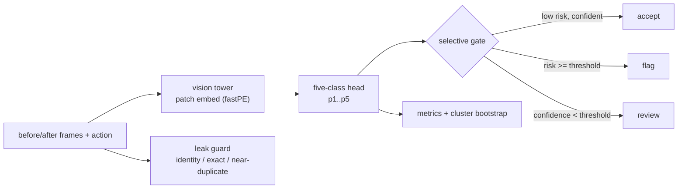

# GUI-Transition-Verifier

A framework for **multimodal state-anomaly verification, operator-level inference
acceleration, process-reward modelling and tool-protocol alignment** for GUI
agents.

The verifier looks at a `(before, after)` screenshot pair plus the action that
was executed, and answers a five-class question about the transition:

| Index | Class | Meaning |
| --- | --- | --- |
| 0 | `1_hijack` | the transition was hijacked or maliciously redirected |
| 1 | `2_paired_safe` | the paired transition is safe |
| 2 | `3_legit_cred` | legitimate credential entry |
| 3 | `4_surprising` | surprising but benign |
| 4 | `5_benign_misplace` | benign misplacement |

Around that core the repository collects the four pieces that made the verifier
usable rather than merely accurate on a leaderboard: a Conv3d-free patch
embedding, a fail-closed Qwen ComputerUse protocol adapter, post-training
diagnostics (gradient conflict, selective abstention, calibration), and a
deterministic evaluation stack with cluster-aware intervals and leakage guards.

---

## Architecture

```text
  screenshot pair + action
            |
            v
  +-------------------------+        +----------------------------+
  | Qwen3-VL vision tower   |        | fastpe/                    |
  |  patch_embed: Conv3d    |<------>|  Conv3d -> F.linear        |
  |  (reversible per call)  |        |  parity audit + review gate|
  +-------------------------+        +----------------------------+
            |
            v
  +-------------------------+        +----------------------------+
  | five-class verifier     |------->| diagnostics/               |
  | p1 .. p5                |        |  gradient conflict probe   |
  +-------------------------+        |  accept / flag / review    |
            |                        |  ECE + temperature scaling |
            v                        +----------------------------+
  +-------------------------+
  | eval/                   |        +----------------------------+
  |  macro-F1, AUC suite    |------->| protocols/                 |
  |  cluster bootstrap CI   |        |  <tool_call> parser        |
  |  leak guard             |        |  0-999 -> screenshot px    |
  +-------------------------+        +----------------------------+
```



---

## Core results

All numbers below are **frozen project measurements**, not leaderboard claims.
The protocol column is part of the number: read it before comparing rows.

| Area | Setting | Metric | Value | Protocol |
| --- | --- | --- | --- | --- |
| State verification | Zero-shot B0 | 5-class Macro-F1 | 47.09% | RSWT 966-row frozen test, argmax |
| State verification | M1-A, safety-weighted LoRA | 5-class Macro-F1 | **68.57%** | same 966 rows |
| State verification | M1-A + E5-A1 adapter soup | 5-class Macro-F1 | 68.77% | same 966 rows, exploratory |
| Operator speed | fastPE vs BF16 | end-to-end P50 | 7,524.8 -> 148.0 ms (**50.8x**) | 966 rows, paired per sample, same physical GPU |
| Operator speed | fastPE vs BF16 | GPU scoring P50 | 7,489.4 -> 133.2 ms (56.2x) | same run |
| Operator speed | fastPE vs BF16 | argmax flips | 15/966 (1.55%) | 7/966 alert flips; 3 true class-1 alerts cancelled |
| Process judging | Action Judge V3 | held-out accuracy | **136/136** | 136-row controlled held-out; M1-A 87/136, V2 97/136 |
| Process judging | Learned process reward | Macro-F1 | **81.04%** (110/136) | V3 held-out; M1-A 58.55%, V2 60.60% |
| Process judging | Incremental reward update | correct | 63/69 vs 54/69 | separate 84-row evaluation, 69 kept after near-duplicate protection |
| Protocol alignment | Zero-shot V2 | task success | **59/80 (73.75%)** | 80 new MiniWoB++ task/seed instances; V1 0/80 |
| Protocol alignment | Zero-shot V2 | executable actions | 267/274 (97.45%) | V1 263/583 (45.11%) |

### What these numbers do not say

* The 966-row RSWT split had already been used repeatedly during development.
  It is a **reused frozen test**, not a fresh blind set, and no confidence
  interval is reported here for the Macro-F1 deltas.
* V1 and V2 zero-shot runs are **unpaired**: they differ in seeds, tool schema,
  action structure, coordinate convention and output-token budget. The
  0/80 -> 59/80 change estimates the combined protocol fix, not the causal
  effect of any single change.
* fastPE is **not lossless** under BF16. Fifteen argmax decisions changed on
  966 rows and three real hijack alerts were cancelled. The fast path is
  therefore opt-in, and high-risk rows must be re-scored with the original
  convolution.
* The judge and reward results come from controlled page states and a
  task-family transfer setting, not from natural applications or adversarial
  attacks. Class 4 is the smallest class and its F1 is correspondingly fragile.

---

## Repository layout

```text
fastpe/
  fast_patch_embed.py     Conv3d -> GEMM, reversible per call, parity budget
  benchmark_parity.py     latency percentiles, drift, argmax/threshold flips
protocols/
  qwen_computer_use_v2.py tool schema, strict parser, single coordinate scaling
diagnostics/
  gradient_conflict.py    per-layer LoRA gradient cosine probe
  selective_abstention.py accept / flag / review, risk-coverage, calibration
eval/
  metrics_core.py         Macro-F1, AUC suite, cluster bootstrap, paired tests
  leak_guard.py           identity, exact and near-duplicate isolation
examples/
  sample_schema.jsonl     three synthetic records, no real data
tests/
  test_repo_smoke.py      CPU tests for every module above
```

Each module is importable on its own. There is no `sys.path` mutation, no
absolute project path, and no dataset dependency.

---

## Quick start

```bash
python -m venv .venv
# Windows: .venv\Scripts\activate
# POSIX:   source .venv/bin/activate
pip install -r requirements.txt

pytest tests/test_repo_smoke.py -q
```

The smoke suite runs on CPU and needs no checkpoint. It verifies:

* `fastpe` forward equivalence in float64, weight sharing, mode switching,
  rejection of unsupported geometry, and the parity gate;
* `protocols` coordinate bounds, single-scaling behaviour, all five actions,
  scroll sign, and the malformed-call paths;
* `eval` macro-F1, AUC, threshold regimes, cluster bootstrap determinism,
  McNemar, validation gates;
* `diagnostics` cosine edge cases, layer aggregation, three-state priority,
  coverage/accuracy separation, ECE and temperature fitting;
* `eval.leak_guard` dHash distance, near-duplicate rule, manifest validation,
  group-level rejection propagation.

Measure the operator:

```bash
python -m fastpe.benchmark_parity --patches 4096 --iterations 30
# CUDA + BF16:
python -m fastpe.benchmark_parity --device cuda --dtype bfloat16 --patches 4096
```

The process exits non-zero when the parity audit asks for full-precision
review, so it can be wired directly into a rollout gate.

### Using the fast path

```python
from fastpe import FastPatchEmbed, apply_fastpe, audit_parity

replaced = apply_fastpe(model, mode="gemm")     # reversible, shares weights
...
model.vision.patch_embed.set_mode("original")   # per-request fallback
```

The wrapper accepts the **already patchified** tensor
`[N, C * T * P * P]`; it does not perform image patchification.

### Parsing a model tool call

```python
from protocols import Geometry, parse_tool_call

action = parse_tool_call(
    raw_model_output,
    Geometry(498, 321),
    space="normalized",      # or "pixel"
    viewport=Geometry(332, 214),
)
action.command               # "mouse_click(249.0, 160.5)"
```

Normalized `[0, 999]` coordinates are converted to **screenshot** pixels once.
The viewport is validated but deliberately not applied: BrowserGym's
`map_coordinates` performs that second conversion internally. Applying it twice
is the bug this module exists to prevent.

---

## Design invariants

1. **Fail closed.** Parsing, coordinate conversion, threshold selection and
   manifest loading raise instead of guessing. A verifier that repairs the
   model's output cannot measure the model.
2. **One scaling, one place.** `0-999 -> screenshot pixels` happens once, in
   `to_screenshot_coords`. Viewport mapping belongs to the environment.
3. **Review is not correctness.** Rows sent to `review` are excluded from
   accuracy and reported as coverage. Flagged rows are scored by alert
   precision and by missed hijacks that were accepted.
4. **Clusters, not rows.** Confidence intervals resample episodes, segments or
   donors. A single cluster raises rather than producing a zero-width interval.
5. **Labels are gated.** `label_status != "verified"` records cannot enter
   classification metrics; sensitivity-only records go through paired drift
   reporting instead.
6. **Rejection is conservative.** One near-duplicate frame rejects the whole
   `(task, seed)` group. The rule is a safety net, not a proof of semantic
   separation.
7. **Acceleration is reversible.** `FastPatchEmbed` shares parameters and keeps
   the original module reachable, so a high-risk row can always be rescored at
   full precision.

---

## Data, privacy and leakage

This repository contains **no datasets, no screenshots, no model weights and no
protected-test manifests**. `examples/sample_schema.jsonl` holds three synthetic
records with fabricated scores.

The leak guard documents the policy the project used, but the policy is only as
strong as its enforcement:

* identity isolation is a direct-field screen, not semantic isolation;
* the near-duplicate rule (dHash distance <= 3 and mean 32x32 grayscale
  difference <= 2) is conservative and can produce false rejections;
* a manifest is a declaration until every collection and training workflow
  actually loads it.

---

## Limitations

* One model family (Qwen3-VL-8B-Instruct) and one verifier architecture.
* The 966-row evaluation split is reused; treat small deltas as noise.
* BF16 GEMM and cuDNN convolution are not bitwise identical; the reported flip
  rate is specific to the audited checkpoint and input distribution.
* The process judge and reward were validated on controlled MiniWoB page states
  with a small number of task families.
* `eval/metrics_core.py` reports classical intervals; it does not correct for
  repeated model selection across many candidate configurations.

---

## License

No license is declared yet. Add a `LICENSE` file before treating this as a
formal open-source release.
