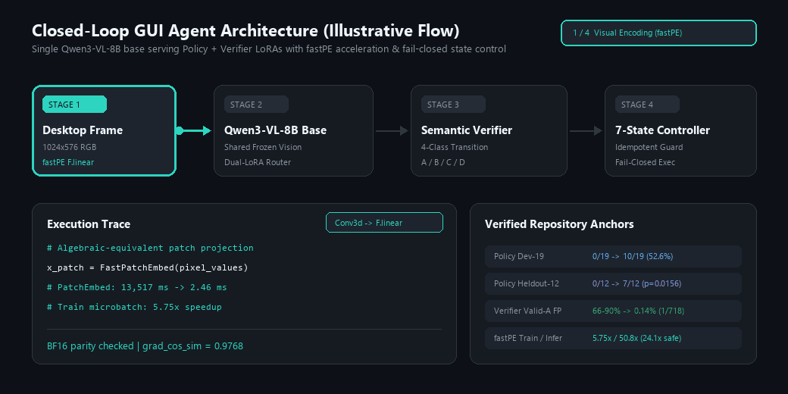
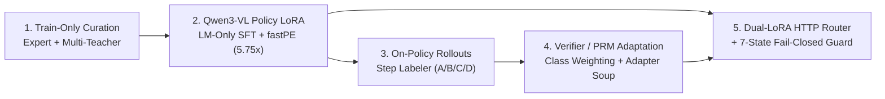

<div align="center">

# GUI-Transition-Verifier

**Post-Training, Transition Verification & Operator Acceleration for Multimodal GUI Agents**

[**English**](README.md) · [**简体中文**](README_CN.md)

<p>
  <a href="https://github.com/ca1tshame/GUI-Transition-Verifier/actions/workflows/ci.yml"></a>
  
  
  
  
  
</p>

<p>
  <a href="#-visual-walkthrough">Demo</a> •
  <a href="#-highlights">Highlights</a> •
  <a href="#-architecture">Architecture</a> •
  <a href="#-benchmarks">Benchmarks</a> •
  <a href="#-quickstart">Quickstart</a> •
  <a href="#-scope--license">Scope &amp; License</a>
</p>

</div>

---

**GUI-Transition-Verifier** is a post-training, transition verification, and inference acceleration framework for **`Qwen3-VL-8B-Instruct`** in closed-loop desktop GUI environments. It unifies leakage-isolated Policy LoRA SFT, safety & process reward modeling (PRM), fail-closed 7-state control, and `Conv3d → F.linear` vision acceleration (`fastPE`) into one reproducible codebase.

> **Companion Project:** [**MiniMind-O Action**](https://github.com/ca1tshame/minimind-o-action) — explores the **lightweight** edge: pretraining a **63.9M Dense LM from scratch** (`3.61B` tokens) + frozen SigLIP2 (`5/6-Tile Focus Crop`) for resource-constrained BrowserGym & OpenApps control.

---

## 🎬 Visual Walkthrough

<table>
  <tr>
    <td align="center" width="52%">
      <br/>
      <sub><b>Closed-Loop Dual-LoRA + 7-State Flow</b> — single <code>Qwen3-VL-8B</code> base serving Policy &amp; Verifier LoRAs with <code>fastPE</code></sub>
    </td>
    <td align="center" width="48%">
      <br/>
      <sub><b>Core Empirical Results</b> — generated directly from <code>results/*.json</code> (Policy SFT, Verifier FP reduction, <code>fastPE</code>)</sub>
    </td>
  </tr>
</table>

---

## ✨ Highlights

* **🎯 Closed-Loop Policy Post-Training (`policy/`)**: Curates `4,534` train-only trajectories with 3-layer SHA-256 + perceptual hash isolation, lifting `Qwen3-VL-8B` on OpenApps Dev from `0/19 →` **`10/19 (52.63%)`** and one-shot frozen Heldout from `0/12 →` **`7/12 (58.33%, p=0.0156)`**.
* **🛡️ Transition Safety & Process Verification (`training/`, `prm/`)**: Solves minority-class collapse via sample-level class weighting and cross-term-free `Adapter Soup`, lifting 5-class RSWT Macro-F1 from `47.09% →` **`68.77%`** (`0/265` benign false alarms). On OpenApps Dev-936, `adapted_v5` cuts valid-step false alarms from `66%–90% →` **`0.14%`**; paired with a 4-class PRM (`81.04%` Macro-F1) and 7-state guard (`24/24` controlled tasks).
* **⚡ `fastPE` Operator & Cascade Acceleration (`fastpe/`)**: Replaces non-overlapping 3D patch `nn.Conv3d` with algebraic-equivalent `F.linear`, delivering **`5.75×`** training microbatch speedup (`grad_cos_sim=0.9768`) and **`50.8×`** P50 safety inference speedup (`7,524.8 → 148.0 ms`), or **`24.12×`** under an Alert-Safe Cascade with **zero missed hijack alerts**.
* **🔬 Reproducible Verification Suite (`eval/`, `tests/`)**: Includes **`51` CPU unit tests**, leakage guards, and `eval/v5_recompute.py` to independently recompute all Wilson CIs, McNemar `p`-values, and confusion matrices from [`results/`](results/).

---

## 🏗️ Architecture



<details>
<summary><b>Repository Modules (8 packages, 51 CPU tests)</b></summary>

| Package | Core Responsibility |
| --- | --- |
| [`policy/`](policy/) | LM-only Policy LoRA SFT, step-level `A/B/C/D` labeler, Verifier SFT, single-base Dual-LoRA router, and 3-arm OpenApps evaluator |
| [`training/`](training/) | Sample-level `batch=1` class-weight fix, unilateral positive margin loss, and cross-term-free `Adapter Soup` |
| [`prm/`](prm/) | Single-token `ABCD` / `AB` logit scoring and fail-closed 7-state idempotent controller |
| [`fastpe/`](fastpe/) | Reversible `Conv3d → F.linear` vision patch projection (`FastPatchEmbed`), two-stage `CascadeRunner`, and parity CLI |
| [`protocols/`](protocols/) | Versioned `<tool_call>` schema, fail-closed parser, and unified `[0, 1000]^2` coordinate scaling |
| [`diagnostics/`](diagnostics/) | Per-layer LoRA gradient conflict probe and selective abstention / calibration audits |
| [`eval/`](eval/) &amp; [`results/`](results/) | 3-layer exact + `dHash+gray32` leakage guard, statistical test suite, and `v5_recompute.py` verifier |
| [`tools/`](tools/) &amp; [`tests/`](tests/) | Pre-publication hygiene audit (`audit_repo.py`) and `51` CPU unit/regression tests |

</details>

---

## 📊 Benchmarks

### 1. OpenApps Policy Post-Training (Closed-Loop, `1024×576`)

| Split &amp; Checkpoint | Train Mix | Whole-Task Pass | Official Subtasks | 95% Wilson CI |
| --- | --- | --- | --- | --- |
| **Dev-19** `M0 Zero-Shot` | — | `0/19` (`0.00%`) | `0/55` | `[0.00%, 16.82%]` |
| **Dev-19** `M1 Expert Ep2` | `3,103` expert | `9/19` (`47.37%`) | `34/55` (`61.82%`) | `[27.33%, 68.29%]` |
| **Dev-19** `M3 Skill-Gap Ep2` (**Best**) | `4,534` curated | **`10/19` (`52.63%`)** | **`37/55` (`67.27%`)** | `[31.71%, 72.67%]` |
| **Heldout-12** `M0 Zero-Shot` | — | `0/12` (`0.00%`) | `1/36` (`2.78%`) | `[0.00%, 24.25%]` |
| **Heldout-12** `M3 Ep2` (**One-Shot**) | `4,534` curated | **`7/12` (`58.33%`)** | **`27/36` (`75.00%`)** | `[31.95%, 80.67%]` |

> Paired exact McNemar vs. zero-shot `M0`: **`p = 0.0020`** on Dev-19 and **`p = 0.0156`** on one-shot frozen Heldout-12 (zero test-set tuning).

### 2. Verification, Protocol Control &amp; `fastPE` Speedup

| Benchmark / Module | Baseline | Ours | Key Result |
| --- | --- | --- | --- |
| **RSWT 5-Class Safety (966 Test)** | Zero-shot `47.09%` F1 | **`68.77%` Macro-F1** | `SOUP-AE` merge; `0/265` benign false alarms |
| **OpenApps Dev-936 Verifier** | Zero-shot FP `66%–90%` | **`0.14%` FP (`1/718`)** | Cuts valid-step false alarms; Class-B recall `88.37%` |
| **Tool Protocol &amp; PRM Guard** | Legacy `0/80` | **MiniWoB `59/80`**, **`24/24` loop** | PRM `81.04%` Macro-F1 + 7-state stale guard |
| **`fastPE` Policy Train (A800)** | `Conv3d` `32.91s` / step | **`5.73s` (`5.75×`)** | `grad_cos_sim = 0.9768`; greedy infer `2.21×` (`20/20` type match) |
| **`fastPE` Safety Infer (966)** | `Conv3d` P50 `7,524.8 ms` | **`148.0 ms` (`50.8×`)** | Alert-Safe Cascade: **`24.12×`** (`0` missed hijack alerts) |

---

## 🚀 Quickstart

```bash
git clone https://github.com/ca1tshame/GUI-Transition-Verifier.git
cd GUI-Transition-Verifier
python -m venv .venv
# Windows: .venv\Scripts\activate   |   POSIX: source .venv/bin/activate
pip install -r requirements.txt

python -B tools/audit_repo.py                  # Repo hygiene & leakage-safety audit
python -B -m pytest -p no:cacheprovider -v     # All 51 CPU unit & regression tests
python -B -m eval.v5_recompute                 # Recompute all CIs, McNemar p & F1 from results/
```

<details>
<summary><b>Full GPU Training, Dual-LoRA Serving &amp; Closed-Loop Evaluation Commands</b></summary>

Requires local `Qwen/Qwen3-VL-8B-Instruct` weights, `pip install ".[all]"`, and an external Playwright + BrowserGym + OpenApps environment.

```bash
# 1. Policy LoRA SFT (M3)
python -B -m policy.train_policy_sft --model-path /path/to/Qwen3-VL-8B-Instruct \
  --split /path/to/train.jsonl --manifest /path/to/manifest.json \
  --prompt-config /path/to/prompt_cfg.json --output-dir runs/m3_policy

# 2. Semantic Verifier LoRA SFT
python -B -m policy.train_verifier_sft --model-path /path/to/Qwen3-VL-8B-Instruct \
  --v-train /path/to/v_train.jsonl --v-val /path/to/v_val.jsonl --output-dir runs/verifier_v5

# 3. Single-base Dual-LoRA router & 3-arm closed-loop evaluation
python -B -m policy.dual_lora_router --model-path /path/to/Qwen3-VL-8B-Instruct \
  --prompt-config /path/to/prompt_cfg.json --policy-adapter runs/m3_policy/final_adapter \
  --verifier-adapter runs/verifier_v5/best_adapter --port 39850
python -B -m policy.eval_openapps --run-tag heldout_arm_c --split heldout --mode verifier \
  --api-url <SERVER_URL> --task-freeze-json /path/to/openapps_task_freeze.json \
  --tasks-yaml /path/to/longer_horizon.yaml --output-dir runs/eval --confirm-one-shot-heldout
```

</details>

---

## 📦 Scope & License

* **Experimental Scope & Roadmap**: All raw evaluation tables (including the 3-arm online Verifier ablation where `Arm C` tied Dev at `10/19` and scored `6/12` on Heldout, and the `batch=1` class-weight fix in `training/losses.py`) are preserved in [`results/`](results/) for reproducibility. Future work extends the per-sample weighting fix to 4-class OpenApps Verifier retraining to boost Class-C semantic error recall.
* **Licensing & Assets**: Source code is licensed under **Apache-2.0** ([`LICENSE`](LICENSE)). Model weights, screenshots, and third-party benchmarks are not redistributed (`OpenApps` is **CC BY-NC 4.0**; `Qwen3-VL-8B-Instruct` follows its upstream license).
