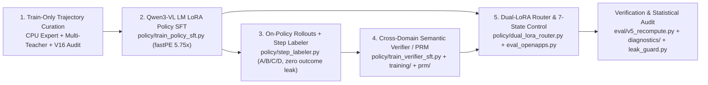

# GUI-Transition-Verifier

**Multimodal GUI Policy Learning, Transition Verification, and Process Reward Modeling** built around **Qwen3-VL-8B-Instruct**, unifying real-environment **Policy LoRA post-training**, **zero-leakage cross-domain Semantic Verifier / PRM adaptation**, **fail-closed tool-use alignment and 7-state control**, and **`Conv3d -> F.linear` operator acceleration (`fastPE`)**.

---

## Headline Results & Honest Scope

| Benchmark / Capability | Baseline | Adapted V5 | Key Finding & Explicit Boundary |
| --- | --- | --- | --- |
| **OpenApps 19-Task Dev (Closed-Loop)** | M0 Zero-Shot: `0/19` (`0.00%`)<br>M1 Expert-Only Ep2: `9/19` (`47.37%`) | **`M3 Ep2` (`BEST_POLICY`)**: **`10/19` (`52.63%`)**<br>Wilson 95% CI: `[0.3171, 0.7267]` | Official subtasks `37/55` (`67.27%`); solves both `DeleteToDo`-class Dev tasks where M1 scored `0%`. Small `n=19` sample (`McNemar vs M0 p=0.001953`). |
| **OpenApps 12-Task One-Shot Heldout** | M0 Zero-Shot: `0/12` (`0.00%`) | **`Arm A` (`M3 Ep2`, Pure Policy)**: **`7/12` (`58.33%`)**<br>Wilson 95% CI: `[0.3195, 0.8067]` | Run once (`seed=915`, 6 task components, zero tuning). Official subtasks `27/36` (`75.00%`), **`Arm A (7/12) vs M0 Zero-Shot (0/12), paired exact McNemar p=0.015625`**. Small `n=12` sample; not a generic GUI benchmark score. |
| **OpenApps Dev-936 Semantic Verifier** | MiniWoB/RSWT zero-shot:<br>Macro-F1 `0.0704–0.2148`<br>False alarms on valid `A`: **`66.0%–89.7%`** | **`adapted_v5` (Zero-Leakage LoRA)**:<br>Acc **`0.8194`**, Macro-F1 **`0.4510`**<br>False alarms on valid `A`: **`0.14%` (`1/718`)** | Trained strictly on disjoint `Train` transitions (`V-Train 713 / V-Val 582`). Class-B stagnation recall **`88.37%`** (`38/43`), Class-C precision **`92.31%`** (`12/13`), **but Class-C recall remains `7.50%` (`12/160`)**. |
| **Online Verifier Feedback Ablation** | Dev Arm A/B: `10/19` / `10/19`<br>Heldout Arm A/B: `7/12` / `7/12` | Dev Arm C (`+ adapted_v5`): `10/19`<br>Heldout Arm C (`+ adapted_v5`): `6/12` (`50.00%`) | **Learned Verifier did NOT improve online task completion** (`McNemar p=1.0`, `+0.76s/step` overhead) due to low Class-C recall (`7.5%`), conservative `V-Val` thresholds (`0.65/0.65`), and `0`-intervention dual-LoRA variance on 1 task. |

---

## 1. End-to-End Algorithm Pipeline & Architecture

Rather than treating data engineering, policy SFT, process verification, and kernel speedups as separate utilities, the repository connects five stages into a single leakage-isolated workflow:



### Repository Layout

`policy/` provides a **clean refactored reference implementation** of the V5 training, serving, and closed-loop evaluation pipeline used on the GPU cluster—preserving the core algorithms, loss formulations, and hyperparameters while decoupling private cluster paths and internal capture wrappers.

```text
policy/
  __init__.py               Public V5 training, labeling, and serving exports
  collator.py               Qwen3-VL ComputerUse SFT collator (-100 prefix mask) & A/B/C/D prompts
  step_labeler.py           Objective step-level 4-class labeler (zero episode-outcome copying)
  train_policy_sft.py       LM-only 252-module LoRA trainer with SHA256/leakage gate & fastPE
  train_verifier_sft.py     Single-sample M-RoPE-consistent 4-class Verifier LoRA trainer & V-Val tuner
  dual_lora_router.py       Thread-safe single-base HTTP router switching 'policy' and 'verifier' LoRAs
  eval_openapps.py          3-arm (policy/rules/verifier) evaluator, per-app CompositeTask check, CDP fallback
training/
  losses.py                 Effective-number class weights, batch=1 fix, unilateral positive margin
  adapter_soup.py           Cross-term-free rank-concatenated LoRA merge & equivalence verifier
prm/
  scoring.py                Single-token ABCD / AB last-position logit scoring & losses
  controller.py             Fail-closed 7-state idempotent controller & non-idempotent stale guard
fastpe/
  fast_patch_embed.py       Reversible Conv3d -> F.linear vision patch projection & parity auditor
  cascade.py                Two-stage gemm -> original CascadeRunner & preset risk gates
  benchmark_parity.py       Latency percentiles, numerical drift, argmax/risk-band flip CLI
protocols/
  qwen_computer_use_v2.py   Versioned <tool_call> schema, fail-closed parser, single coordinate scaling
diagnostics/
  gradient_conflict.py      144-module per-layer LoRA gradient cosine probe
  selective_abstention.py   accept/flag/review gate, ECE, Temperature Scaling vs Platt AUC audit
eval/
  leak_guard.py             Identity, SHA-256 exact, and dHash+gray32 near-duplicate isolation
  metrics_core.py           5-class Macro-F1, midrank AUC, cluster bootstrap CI, McNemar
  v5_recompute.py           Recomputes Dev/Heldout Wilson CIs, McNemar p-values, and Verifier F1 from results/
results/
  policy_dev_summary.json   Permuted 19-task Dev anonymized outcomes, Wilson CIs, and paired McNemar
  policy_heldout_summary.json Aggregated 12-task Heldout outcomes & paired 2x2 contingency tables (task vectors withheld)
  verifier_metrics.json     Raw 4x4 confusion matrices for Dev-936 zero-shot vs adapted_v5 & V-Val epochs
  training_configs.json     M3 & Verifier dataset splits, overlap assertions (all 0), and LoRA configs
  performance_benchmarks.json PatchEmbed tensor/grad/inference parity & [0,1000]^2 grid L2 benchmarks
tools/
  audit_repo.py             Pre-publication size, suffix, and sensitive-pattern scanner
tests/
  test_repo_smoke.py, test_new_modules.py, test_blindspots.py, test_policy_v5.py
```

---

## 2. OpenApps Policy Post-Training & Closed-Loop Findings (`policy/`)

### 2.1 Epoch × Data Quality Double Dissociation on 19-Task Dev

All V5 policy runs (`M1 Ep1/Ep2`, `M2 Ep1`, `M3 Ep1/Ep2`, `Arm B`, `Arm C`) share identical inference settings (`Qwen3-VL-8B-Instruct`, `131072` px, `1024x576` desktop, `seed=911`, `max_steps=25`, `fastPE` enabled, and official per-app-group `CompositeTask` subtask scoring in `policy/eval_openapps.py`):

| Policy Checkpoint | Train Mix | Dev-380 NLL | 19-Dev Whole-Task | Wilson 95% CI (`n=19`) | Official Subtasks (`n=55`) |
| --- | --- | --- | --- | --- | --- |
| `m0_zeroshot` (V4 baseline) | Zero-shot base | — | `0/19` (`0.00%`) | `[0.0000, 0.1682]` | `0/55` (V4 baseline) |
| `dev_m1_ep1` (Step 194) | 3,103 expert-only | `0.16664` | `2/19` (`10.53%`) | `[0.0294, 0.3139]` | `17/55` (`30.91%`) |
| `dev_m2_ep1` (Step 194) | 2,877 expert + 226 visual teacher | `0.15424` | `8/19` (`42.11%`) | `[0.2314, 0.6372]` | `30/55` (`54.55%`) |
| `dev_m1_ep2` (Step 388) | 3,103 expert-only | `0.21898` | `9/19` (`47.37%`) | `[0.2733, 0.6829]` | `34/55` (`61.82%`) |
| `m2_ep2_v4` (Step 388, V4) | 2,877 expert + 226 visual teacher | `0.19614` | `3/19` (`15.79%`) | `[0.0552, 0.3757]` | `37/55` (V4 heuristic) |
| `dev_m3_ep1` (Step 284) | 4,534 skill-gap M3 | `0.02739` | `8/19` (`42.11%`) | `[0.2314, 0.6372]` | `32/55` (`58.18%`) |
| **`dev_m3_ep2` (`BEST_POLICY`, Step 568)** | **4,534 skill-gap M3** | **`0.03287`** | **`10/19` (`52.63%`)** | **`[0.3171, 0.7267]`** | **`37/55` (`67.27%`)** |

* **Offline NLL does not predict closed-loop execution**: `dev_m1_ep1` has lower offline NLL (`0.16664`) than `dev_m1_ep2` (`0.21898`), yet completes only `2/19` online vs `9/19` (`McNemar p = 0.015625`) because Ep1 has not converged on critical form-submit button clicks. Conversely, `M2` peaks at Ep1 (`8/19`) and drops to `3/19` at Ep2 alongside observed form-abandonment events (`4` vs `0` for `M1`) and premature app switches—consistent with Ep2 overfitting noisy short-horizon visual teacher fragments (though single-variable ablations are required to isolate exact causality).
* **Targeted Train-only skill transfer**: Filtering short/1080p teacher fragments (`209` dropped, keeping `47` multi-step) and adding `1,196` complete Train-only CPU expert gap episodes (`4,534` total rows; `0` Dev/Heldout overlap across task, episode, and SHA-256 frames) enabled `M3 Ep2` to solve both `DeleteToDo`-class Dev tasks (`0/2 -> 2/2`), reaching **`10/19` (`McNemar vs M0 p = 0.001953`)**.
* **Normalized `[0, 1000]^2` click L2 recalibration (`results/performance_benchmarks.json`)**: On fixed matched intersections (`M1 ∩ M2`, `n = 139` OpenApps Dev clicks), `M1` maintains `37.17` mean Euclidean error (`p90 = 39.32`) vs `M2`'s `74.20` (`p90 = 170.36`, skewed by tail dock misclicks).

### 2.2 Controlled 3-Arm Dev & One-Shot Frozen Heldout-12 Evaluation

Using frozen `BEST_POLICY` (`M3 Ep2`), frozen `adapted_v5`, and `V-Val`-locked thresholds (`tau_c = 0.65`, `tau_b = 0.65`, **zero tuning on Dev or Heldout**):

| Split & Arm | Mode | Whole-Task Pass | Wilson 95% CI | Official Subtasks | Wall Time / Steps | Interventions (`Rule / Verifier`) |
| --- | --- | --- | --- | --- | --- | --- |
| Dev-19 Arm A (`dev_m3_ep2`) | `policy_only` | `10/19` (`52.63%`) | `[0.3171, 0.7267]` | `37/55` (`67.27%`) | `2067.8s` / 392 | `0 / 0` |
| Dev-19 Arm B (`dev_arm_b_rules`) | `rules` | `10/19` (`52.63%`) | `[0.3171, 0.7267]` | `37/55` (`67.27%`) | `2077.6s` / 393 | `2 / 0` |
| Dev-19 Arm C (`dev_arm_c_verifier`) | `verifier` | `10/19` (`52.63%`) | `[0.3171, 0.7267]` | `37/55` (`67.27%`) | `2262.1s` / 393 | `2 / 0` (`383` calls) |
| Heldout-12 (`heldout_m0`) | Zero-shot `policy_only` | `0/12` (`0.00%`) | `[0.0000, 0.2425]` | `1/36` (`2.78%`) | `480.4s` / 92 | `0 / 0` |
| **Heldout-12 (`heldout_arm_a`)** | `policy_only` (`M3 Ep2`) | **`7/12` (`58.33%`)** | **`[0.3195, 0.8067]`** | **`27/36` (`75.00%`)** | `1338.4s` / 257 | `0 / 0` (`vs M0 p=0.015625`) |
| Heldout-12 (`heldout_arm_b`) | `rules` | `7/12` (`58.33%`) | `[0.3195, 0.8067]` | `27/36` (`75.00%`) | `1352.7s` / 258 | `0 / 0` (`vs Arm A p=1.0`) |
| Heldout-12 (`heldout_arm_c`) | `verifier` | `6/12` (`50.00%`) | `[0.2538, 0.7462]` | `26/36` (`72.22%`) | `1556.0s` / 274 | `0 / 1` (`268` calls, `p=1.0`) |

---

## 3. Cross-Domain Semantic Verifier & Legacy 4-Pillar Results

### 3.1 OpenApps Dev-936 Semantic Verifier Adaptation (`results/verifier_metrics.json`)

From V4 `M0/M1/M2` Dev rollouts, `policy/step_labeler.py` builds a read-only `936`-step benchmark (`A=718`, `C=160`, `B=43`, `D=15`) strictly from observable step evidence. A parent- and image-disjoint Train-only dataset (`V-Train=713`, `V-Val=582`) is constructed from `30` on-policy Train rollouts (`20/30` success) plus Train teacher/expert traces, and trained at `--micro-batch-size 1` to preserve Qwen3-VL M-RoPE parity:

| Verifier (Dev-936 Read-Only) | Accuracy | Macro-F1 (4-cls) | Class-B Stagnation Rec | Class-C Semantic Err Prec / Rec | False Alarm on True `A` | Latency (ms/step) |
| --- | --- | --- | --- | --- | --- | --- |
| `reward_v3` (MiniWoB zero-shot) | `0.1261` | `0.0987` | `0.9767` | `0.1415` / `0.0938` | **`0.7702`** | `301.37` |
| `reward_biz` (MiniWoB+biz zero-shot) | `0.1891` | `0.1313` | `0.9535` | `0.1143` / `0.0750` | **`0.6602`** | `300.71` |
| `judge_v3` (MiniWoB binary zero-shot) | `0.1250` | `0.0704` | `1.0000` | `0.0000` / `0.0000` | **`0.8969`** | `298.01` |
| `rswt_m1a` (RSWT safety zero-shot) | `0.7329` | `0.2148` | `0.0000` | `1.0000` / `0.0063` (`1/160`) | `0.0000` | `297.04` |
| **`adapted_v5` (Zero-Leakage LoRA)** | **`0.8194`** | **`0.4510`** | **`0.8837` (`38/43`)** | **`0.9231` (`12/13`) / `0.0750` (`12/160`)** | **`0.0014` (`1/718`)** | `382.99` |

### 3.2 `fastPE` Operator Speedup & Equivalence Boundaries (`fastpe/`, `results/performance_benchmarks.json`)

Replacing Qwen3-VL's non-overlapping 3D patch `nn.Conv3d` (`kernel == stride == (2, 16, 16)`) with parameter-shared `F.linear` yields two complementary verified benchmarks (subject to non-bitwise-identical BF16 GEMM reduction order):

* **OpenApps Policy SFT + Inference (`Qwen3-VL-8B` on A800 under concurrent GPU load)**: Tensor forward (`n=16`) `mean_abs=0.0`, `max_abs=0.007812` (1 BF16 ULP), `13,516.68 ms -> 2.46 ms`; LoRA gradient (`504` tensors) `loss_abs_diff=0.00615`, `global_grad_cos_sim=0.976824`, **`5.75x` end-to-end training microbatch speedup** (`32.909s -> 5.726s`); greedy inference (`20` Dev samples) **`2.21x` end-to-end speedup** (`6.638s -> 3.005s`) with `20/20` action-type parity and `18/20` exact raw match (`coord_l2_1000grid_mean=5.116`).
* **RSWT Safety Scoring + `CascadeRunner` (`fastpe/cascade.py`, 966-row reused Test)**: Unconditional `fastPE` delivers **`50.8x` E2E P50 speedup** (`7,524.8 -> 148.0 ms`) with `15/966` (`1.55%`) argmax flips and `3` missed `1_hijack` alerts; **Alert-Safe Gate** (`p1 in [0.30, 0.75]`) runs at **`24.12x`** speedup (`313.06 ms` mean, `2.17%` fallback, `0` missed `1_hijack`); **Full-Parity Gate** (`+ conf < 0.70`) runs at **`4.62x`** (`19.77%` fallback, `0/966` argmax and risk flips).

### 3.3 Core Verification, Protocol, PRM, and Calibration Summary

| Pillar | Key Modules & Frozen Benchmarks |
| --- | --- |
| **RSWT Safety Verification** | `training/losses.py` (`batch=1` class-weight fix + `pos_only` margin) & `training/adapter_soup.py` (cross-term-free rank concatenation `3.73e-9` error). On 966-row RSWT Test: `B0 47.09% -> M1-A 68.57%` (`SOUP-AE 68.77%`); `0/265` benign false alarms (`1.12%` Clopper-Pearson upper bound). |
| **Tool Protocol & Process Supervision** | `protocols/qwen_computer_use_v2.py` (`0/80 -> 59/80` unpaired MiniWoB++ alignment) & `prm/scoring.py` + `prm/controller.py` (Judge V3 `136/136`, Learned PRM `81.04%` Macro-F1 on controlled 136-row split; 7-state controller `24/24` online, `10/10` non-idempotent guard). |
| **Leakage, Diagnostics & Calibration** | `eval/leak_guard.py` (3-layer exact + dHash+gray32 isolation, filtering `62.51%` near-duplicates in `frozen_v1`), `diagnostics/gradient_conflict.py` (layer-28 `-0.8018` Class-4 opposition), `diagnostics/selective_abstention.py` (Temperature Scaling flips `15/22` cross-sample `p1` ROC-AUC pairs vs strictly monotonic binary Platt scaling). |

---

## 4. Two-Tier Reproducibility & Verification

### Tier 1: CPU Quick Check (Works Out-of-the-Box, ~5 Seconds)

Requires only Python `>= 3.10`, CPU PyTorch, and `pytest`. Runs repo hygiene audits, unit tests across all 7 packages, and independent mathematical recomputation of Dev-19 metrics from permuted anonymized per-task records, Heldout-12 Wilson CIs & exact McNemar `p`-values from aggregate counts and paired 2x2 contingency tables (with per-task vectors withheld), and Verifier F1/recall tables from raw 4x4 confusion matrices in `results/`:

```bash
python -m venv .venv
# Windows: .venv\Scripts\activate   |   POSIX: source .venv/bin/activate
pip install -r requirements.txt

python -B tools/audit_repo.py
python -B -m pytest -p no:cacheprovider -v
python -B -m eval.v5_recompute
```

### Tier 2: Full GPU Training & Live OpenApps Evaluation (External Prerequisites Required)

Full training and online closed-loop runs via the `policy/` reference pipeline additionally require local `Qwen/Qwen3-VL-8B-Instruct` weights, `transformers` + `peft` + `Pillow` (`pip install ".[all]"`), and an external Playwright + BrowserGym + OpenApps installation (not bundled):

```bash
# 1. Policy LoRA SFT (M3)
python -B -m policy.train_policy_sft --model-path /path/to/Qwen3-VL-8B-Instruct \
  --split /path/to/train.jsonl --manifest /path/to/manifest.json \
  --prompt-config /path/to/prompt_cfg.json --output-dir runs/m3_policy

# 2. Semantic Verifier LoRA SFT (micro_batch_size=1 for M-RoPE parity)
python -B -m policy.train_verifier_sft --model-path /path/to/Qwen3-VL-8B-Instruct \
  --v-train /path/to/v_train.jsonl --v-val /path/to/v_val.jsonl --output-dir runs/verifier_v5

# 3. Single-base dual-LoRA server & closed-loop 3-arm evaluation
python -B -m policy.dual_lora_router --model-path /path/to/Qwen3-VL-8B-Instruct \
  --prompt-config /path/to/prompt_cfg.json --policy-adapter runs/m3_policy/final_adapter \
  --verifier-adapter runs/verifier_v5/best_adapter --port 39850
python -B -m policy.eval_openapps --run-tag heldout_arm_c --split heldout --mode verifier \
  --api-url <SERVER_URL> --task-freeze-json /path/to/openapps_task_freeze.json \
  --tasks-yaml /path/to/longer_horizon.yaml --output-dir runs/eval --confirm-one-shot-heldout
```

---

## 5. Honest Counter-Evidence, Limitations, and Licensing

1. **Online Verifier Did Not Improve End-to-End Task Success (`Arm C`) & Historical `batch=1` Class-Weight Cancellation**: While `adapted_v5` cuts Dev-936 true-progress false alarms from `66%–90%` to `0.14%` and raises `Macro-F1` to `0.4510`, semantic-error Class-C recall is only **`7.50%`** (`12/160`). With conservative `V-Val` thresholds (`0.65/0.65`) and a strong `M3` policy (`0` invalid actions), Dev stayed tied (`10/19`) and Heldout moved from `7/12` (`Arm A/B`) to `6/12` (`Arm C`, `p=1.0`). Crucially, on that single diverged task, the Verifier intervened **0 times** across 25 steps (step-6 dock click divergence under dual-LoRA runtime rather than an erroneous intervention), while adding `~0.76s/step` total overhead. In addition, post-hoc code audit of the historical V5 Verifier training run (`policy/train_verifier_sft.py`) revealed that `F.cross_entropy(logits, tgt, weight=cls_weights)` under `micro_batch_size=1` mathematically cancels class weights in PyTorch's default weighted-mean reduction (`w_y * nll / w_y = nll`), even with gradient accumulation. This proves the historical Verifier run did not apply the intended class weights; however, whether adapting `training/losses.py`'s `batch=1` per-sample weighting fix from 5-class RSWT to 4-class OpenApps improves Class-C recall remains an open hypothesis requiring an independent retraining ablation.
2. **Small-Sample Evaluation Bounds**: Dev (`n=19`) and one-shot Heldout (`n=12`, 6 components) carry wide 95% Wilson CIs (`> ±20 pp`), supporting significant gains over zero-shot `M0` (`p=0.0156` / `p=0.0020`) rather than fine-grained `±1` task comparisons. For Heldout-12, per-task vectors and subtask counts are withheld to prevent combinatorial re-identification, while aggregate counts and paired 2x2 contingency tables preserve exact Wilson CI and McNemar recomputation; Dev-19 applies a deterministic permutation as pragmatic anonymization rather than a formal privacy guarantee.
3. **BF16 Numerical Drift in Operator & Dual-LoRA Paths**: `FastPatchEmbed` is algebraically exact in FP64 (`<1e-12`) but exhibits BF16 reduction-order drift (`15/966` RSWT argmax flips; `18/20` exact raw match & `grad_cos_sim=0.976824` on Qwen3-VL Policy), requiring empirical parity checks before deployment on safety-critical paths.
4. **Legacy Methodological Boundaries**: `E4` modality ablation (`-0.7 pp` removing action text on RSWT), `Class-4` local visual ambiguity (`11/12` Dev triples), `Judge V3`/`PRM` controlled MiniWoB scope, and reused 966-row RSWT Test splits remain transparently disclosed.
5. **Licensing & Withheld Assets**: Original source code in this repository is released under the **Apache License 2.0** (`LICENSE`). No model checkpoints, screenshots, private paths, or third-party benchmark code are redistributed here. Experiments against **OpenApps** rely on its upstream repository (licensed under **CC BY-NC 4.0**, with bundled map/shop/icon assets subject to their respective upstream attributions), and checkpoints from `Qwen3-VL-8B-Instruct` remain governed by their upstream license.
