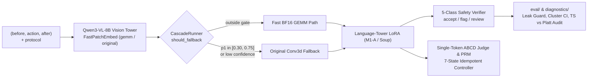

# GUI-Transition-Verifier

A modular engineering and verification framework built around **Qwen3-VL-8B-Instruct** for GUI agents, unifying **state-transition safety verification**, **native tool-use protocol alignment**, **single-token `ABCD` process reward modeling with idempotent control**, and **Conv3d-free operator acceleration with risk-aware cascade fallback**.

---

## 1. Overview and Repository Layout

### Problem Setting and Four Architectural Pillars

Given a `(before, action, after)` GUI state transition, the core verifier predicts a calibrated distribution `(p1 .. p5)` over five transition classes:

| Index | Token | Class | Operational Semantics |
| --- | --- | --- | --- |
| `0` | `A` | `1_hijack` | Malicious redirection, UI injection, or hijacked transition (`HIJACK`) |
| `1` | `B` | `2_paired_safe` | Benign paired transition sharing the `before` state (`SAFE`) |
| `2` | `C` | `3_legit_cred` | Legitimate credential entry sharing a donor `after` screen (`SAFE`) |
| `3` | `D` | `4_surprising` | Surprising yet benign interface state transition (`SAFE`) |
| `4` | `E` | `5_benign_misplace` | Benign misplacement or unintended non-malicious outcome (`ANOMALY_BENIGN`) |

Around this five-class core, the repository organizes four system pillars and two diagnostic/evaluation layers on `Qwen3-VL-8B`:

1. **State-Transition Safety Verification (`training/`)**: Effective-number safety-weighted full-vocabulary LoRA (`M1-A`), unilateral positive margin training (`E5-A1`), and cross-term-free Exact Adapter Soup (`r = 16 + 16 -> 32`, `alpha = 32 + 32 -> 64`).
2. **Native Tool-Use Protocol Alignment (`protocols/`)**: Fail-closed `Qwen ComputerUse` `<tool_call>` schema enforcement, strict argument and type validation (rejecting `bool`-as-`int` and undeclared keys), and single-point `0-999 -> screenshot` coordinate scaling.
3. **Single-Token `ABCD` Process Reward Modeling and 7-State Controller (`prm/`)**: Action Judge V3 (`change` and `goal` over `AB`) and 4-class Learned PRM (`progress`, `no_progress`, `regression`, `recovery` over `ABCD`) reusing the `M1-A` language-tower LoRA without auxiliary MLP heads, paired with a fail-closed 7-state idempotent controller.
4. **`fastPE` Operator Acceleration with Cascade Fallback (`fastpe/`)**: Reversible zero-copy `Conv3d -> F.linear` vision patch projection (`FastPatchEmbed`) paired with a thread-safe two-stage `gemm -> original` `CascadeRunner` evaluated with fixed gates on a reused test split.
5. **Supporting Rigor (`eval/` and `diagnostics/`)**: Three-layer leakage screening (`leak_guard.py`), cluster-resampled bootstrap inference (`metrics_core.py`), 144-module LoRA gradient conflict probing (`gradient_conflict.py`), and selective abstention plus calibration rank-invariance auditing (`selective_abstention.py`).



### Summary of Frozen Empirical Measurements

All headline metrics below are **frozen project measurements** under explicit evaluation protocols rather than generic leaderboard claims:

| Pillar | Setting | Metric | Value | Evaluation Protocol |
| --- | --- | --- | --- | --- |
| Safety verification | Zero-shot `B0` | 5-class Macro-F1 | `47.09%` | 966-row frozen RSWT test split, argmax |
| Safety verification | `M1-A` safety-weighted full-vocab LoRA | 5-class Macro-F1 | **`68.57%`** | Same 966-row test split |
| Safety verification | `M1-A + E5-A1` Exact Adapter Soup | 5-class Macro-F1 | `68.77%` | Same 966-row test split (`r=32`, exploratory delta) |
| Protocol alignment | Zero-shot `V2` vs `V1` | Task success | **`59/80` (`73.75%`)** | 80 MiniWoB++ task/seed instances (`V1`: `0/80`, unpaired) |
| Protocol alignment | Zero-shot `V2` vs `V1` | Executable actions | `267/274` (`97.45%`) | Strict `<tool_call>` adapter (`V1`: `263/583` [`45.11%`]) |
| Process supervision | Action Judge V3 (`AB` logits) | Held-out accuracy | **`136/136`** | 136-row controlled state-change set (`M1-A`: `87/136`, `V2`: `97/136`) |
| Process supervision | Learned PRM (`ABCD` logits) | 4-class Macro-F1 | **`81.04%`** (`110/136`) | Same 136-row held-out (`M1-A`: `58.55%`, `V2`: `60.60%`) |
| Process supervision | Incremental PRM update | Retained accuracy | `63/69` vs `54/69` | 84-row post-update set after `15/84` overlap filtering |
| Process control | 7-state idempotent controller | Online / stale guard | `24/24` / `10/10` | Controlled online episodes / non-idempotent stale-signal test |
| Operator speed | Unconditional `fastPE` (`gemm`) | E2E P50 / GPU P50 | **`50.8x`** / `56.2x` | `7,524.8 -> 148.0 ms` E2E (`15/966` argmax flips, `3` missed hijacks) |
| Operator cascade | **Alert-Safe Gate** (`[0.30, 0.75]`) | Speedup / fallback | **`24.12x`** / `2.17%` | `313.06 ms` mean E2E, **`0` missed `1_hijack`** (`0/966` risk flips) |
| Operator cascade | **Full-Parity Gate** (`+ conf < 0.70`) | Speedup / fallback | `4.62x` / `19.77%` | `1,635.27 ms` mean E2E, **`0/966`** argmax & risk flips |

### Repository Layout

```text
fastpe/
  __init__.py               Public operator, parity, and cascade exports
  fast_patch_embed.py       Conv3d -> F.linear replacement, reversible per call, parity audit
  cascade.py                Two-stage gemm -> original CascadeRunner & preset risk gates
  benchmark_parity.py       Latency percentiles, numerical drift, argmax/risk-band flip CLI
protocols/
  __init__.py               Protocol constants and parser exports
  qwen_computer_use_v2.py   Versioned <tool_call> schema, strict parser, single coordinate scaling
training/
  __init__.py               Training loss and adapter-merging exports
  losses.py                 Effective-number class weights, full-vocab batch=1 fix, pos_only margin
  adapter_soup.py           Cross-term-free rank-concatenated LoRA merge & equivalence verifier
prm/
  __init__.py               Process reward scoring and controller exports
  scoring.py                Single-token ABCD / AB last-position logit scoring & losses
  controller.py             Fail-closed 7-state idempotent controller & non-idempotent guard
diagnostics/
  __init__.py               Gradient-conflict, abstention, and calibration exports
  gradient_conflict.py      144-module per-layer LoRA gradient cosine probe
  selective_abstention.py   accept/flag/review gate, ECE, Temperature Scaling vs Platt AUC audit
eval/
  __init__.py               Evaluation and leakage-protection exports
  metrics_core.py           5-class Macro-F1, midrank AUC, cluster bootstrap CI, McNemar
  leak_guard.py             Identity, SHA-256 exact, and dHash+gray32 near-duplicate isolation
examples/
  sample_schema.jsonl       Three synthetic schema records (zero real screenshots or test rows)
tools/
  audit_repo.py             Pre-publication size, suffix, and sensitive-pattern scanner
tests/
  conftest.py               Declarative pytest configuration hook (no sys.path mutation)
  test_*.py                 Pure-CPU deterministic unit tests across all subpackages
.github/workflows/ci.yml    Cross-version (Python 3.10-3.12) CPU audit and pytest pipeline
pyproject.toml              PEP 621 package metadata, optional dependency groups, pytest config
requirements.txt            Streamlined local CPU verification dependencies
LICENSE                     Apache License 2.0
```

Every subpackage imports cleanly from the repository root without `sys.path` mutation, hardcoded filesystem paths, or external dataset dependencies.

---

## 2. Core Algorithmic Mechanisms and Honest Counter-Evidence

### 2.1 `same-base` and `same-after` Donor Hard Negatives (`E4` Modality Ablation)

To prevent the verifier from degenerating into a single-screen phishing detector, training and evaluation pair `1_hijack` transitions against two complementary hard-negative structures:

* **`same-base` pairs (`1_hijack` vs `2_paired_safe`)**: Identical `before` screenshot followed by diverging `after` states, testing whether the outcome trajectory became malicious.
* **`same-after` donor pairs (`1_hijack` vs `3_legit_cred`)**: Identical sensitive `after` screen (e.g., credential prompt) reached from an incongruent vs legitimate `before` context.

**Honest counter-evidence (`E4` input ablation)**: Under controlled `V0-V3` modality ablations, removing the `before` screenshot collapses 5-class Macro-F1 by **`-45.9 pp`**, confirming genuine cross-frame visual transition comparison rather than `after`-only shortcutting. However, removing the serialized `action` text shifts Macro-F1 by only **`-0.7 pp`**. Rather than overclaiming fine-grained action-text reasoning where visual state transitions already resolve most RSWT pairs, `eval/metrics_core.py` enforces `enforce_label_status` so counterfactual action-perturbation probes (`V4`, `label_status="sensitivity_only"`) are strictly isolated to sensitivity drift metrics rather than headline accuracy.

### 2.2 Safety-Weighted Full-Vocabulary LoRA, Unilateral Margin, and Exact Adapter Soup (`training/`)

* **Effective-number class weights and the `batch=1` cancellation fix (`training/losses.py`)**: Class imbalance is addressed via effective-number weighting `(1 - beta) / (1 - beta**n_c)` (`beta = 0.999`, mean-normalized to `1.0` and capped at `3.0`). Crucially, standard `F.cross_entropy(logits, target, weight=class_weight, reduction="mean")` silently cancels class weights (`w_y / w_y = 1.0`) when `batch_size = 1` on single-token label supervision. `full_vocab_loss` resolves this by applying explicit per-sample weighting `w = class_weight[labels]` to full-vocabulary next-token cross-entropy alongside 5-token candidate auxiliary supervision (`ce + aux_total - F.cross_entropy(z, labels)`), raising frozen 966-row Test Macro-F1 from **`47.09%` (`B0`)** to **`68.57%` (`M1-A`)**.
* **Unilateral positive margin (`E5-A1`, `margin_mode="pos_only"`)**: Applies margin separation unilaterally to suppress competing impostor logits without destabilizing negative-pair calibration, contrasting against `"none"` and symmetric `"both"` modes.
* **Cross-term-free Exact Adapter Soup (`training/adapter_soup.py`)**: Naive factor averaging `0.5 * (B1 + B2) @ 0.5 * (A1 + A2)` introduces cross-term distortion `0.25 * (B1 @ A2 + B2 @ A1)`. `merge_lora_adapters` concatenates `lora_A` along `dim=0` and weighted `lora_B` along `dim=1`, expanding rank `r = 16 + 16 -> 32` (`lora_alpha = 32 + 32 -> 64`, keeping `alpha / r = 2.0`). Across all 144 adapted projection modules on CPU random probes (`verify_adapter_soup_equivalence`), the merged single-pass adapter matches `0.5 * (B1 @ A1) + 0.5 * (B2 @ A2)` to **`3.73e-9`** maximum absolute error and reaches **`68.77%` Macro-F1** on the 966-row test set (reported conservatively as an exploratory single-forward candidate).

### 2.3 144-Module Gradient Conflict Probe and the Class-4 Identifiability Boundary (`diagnostics/`, `E1-E3`)

* **Layer-wise LoRA gradient opposition (`diagnostics/gradient_conflict.py`)**: Probing per-module LoRA gradients across 36 transformer layers and 4 attention projections (`q_proj`, `k_proj`, `v_proj`, `o_proj` = **144 layer-module pairs**) uncovered systematic negative cosine similarity between `4_surprising` (Class 4) and `2_paired_safe` (Class 2): **`-0.4723`** mean cosine across modules, peaking at **`-0.8018` at layer 28**. Under balanced/contrastive `M1-C`, rare Class 4 (`n = 12` on Dev) experienced a **`9.8:1` negative-to-positive gradient exposure ratio**; applying PCGrad (`C-P`) reduced destructive projection conflict algebraically without unlocking substantial Class-4 F1 gains.
* **Local visual unidentifiability (`E1-E3` audit)**: Structural and manual inspection explained why optimizer-level fixes hit an upper bound: **`11/12` Dev Class-4 samples** are visually unidentifiable from a local `(before, action, after)` triple alone without broader multi-step task history, while **`145/150` Test Class-4 samples** exhibit severe upstream source skew (and metadata `app`-switch hypotheses were falsified at `0/273`). This establishes a data observability boundary rather than an optimization defect.

### 2.4 Single-Token `ABCD` Judge/PRM and 7-State Idempotent Controller (`prm/`)

* **M1-A language-tower LoRA reuse (`prm/scoring.py`)**: Both Action Judge V3 and the 4-class Learned PRM initialize from the **`M1-A` safety-aligned Qwen3-VL language-tower LoRA** (with the vision backbone frozen) and score directly over **single-token `ABCD` last-position next-token logits** (`DEFAULT_ABCD_TOKEN_IDS = (32, 33, 34, 35)`), avoiding uncalibrated standalone MLP heads or explicit VisCritic feature-difference modules.
* **Held-out and incremental evaluation**: On the 136-row controlled state-change held-out split, Action Judge V3 (`change` and `goal` binary heads over `AB`) achieves **`136/136`** (`M1-A`: `87/136`, `V2`: `97/136`) and **`20/20`** on paired 4-branch identical-instruction/identical-action groups (`M1-A`: `0/20`, `V2`: `6/20`). The 4-class Learned PRM (`progress`, `no_progress`, `regression`, `recovery`) achieves **`81.04%` Macro-F1** (`110/136` accuracy). Honest per-family analysis identified initial `scroll-text` progress recall weakness (`0/18`) and tied post-hoc pair ranking (`20/20`) against `M1-A` inverse risk; a 64-step incremental PRM update improved accuracy from **`54/69` to `63/69`** on a new 84-row evaluation after conservative near-duplicate screening excluded **`15/84`** group-overlapping rows (`scroll-text` `12/24 -> 24/24`, while `no_progress` false-positive rewards shifted from `1/30` to `3/30`).
* **7-state fail-closed idempotent controller (`prm/controller.py`)**: Maps runtime `Feedback` (strictly excluding privileged DOM Oracle fields from model inputs) into `("continue", "observe", "retry", "recover", "review", "stop", "block")`. Enforces retry/observe budgets, repeated-action loop detection, original-BF16 high-risk safety escalation (`require_original_bf16_safety_review`), and a **non-idempotent stale-failure guard** (`24/24` controlled online episodes with `0` unnecessary retries vs `20/24` under unguarded joint control; **`10/10`** protection against repeated toggling of non-idempotent checkbox/submit controls under stale failure signals).

---

## 3. `fastPE` Inference Acceleration and Cascade Fallback

### 3.1 `Conv3d -> F.linear` Algebraic Equivalence and BF16 Drift

Profiling Qwen3-VL's 3D patch projection (`nn.Conv3d` with `kernel = stride = (2, 16, 16)`, flattened patch dimension `1536 -> 1152`) revealed PyTorch falling back to `aten::slow_conv_dilated3d` (`vol2col` plus device-side copies), consuming **`98.6%` of vision-tower runtime**. Because patches are non-overlapping (`kernel == stride`, `padding = 0`, `dilation = 1`, `groups = 1`), `FastPatchEmbed` (`fastpe/fast_patch_embed.py`) replaces the 3D convolution with a single `F.linear` call sharing the exact parameter tensors (`mode="gemm"` vs `mode="original"`):

* **Numerical parity in FP64**: `< 1e-12` maximum absolute error on CPU across arbitrary batch sizes and bias configurations.
* **Single-GPU speedup**: **`50.8x` end-to-end P50 speedup** (`7,524.8 ms -> 148.0 ms`) and **`56.2x` GPU scoring P50 speedup** (`7,489.4 ms -> 133.2 ms`) across all 966 paired test transitions on the same physical GPU.
* **BF16 reduction-order drift**: Under BF16, GEMM accumulation order is not bitwise identical to cuDNN convolution. Across the 966 paired test rows, unconditional `gemm` caused **`15/966` (`1.55%`) argmax flips** and **`7/966` (`0.72%`) risk-threshold flips**, including **`3` missed `1_hijack` alerts**. Unconditional replacement on safety-critical paths is therefore unsafe.

### 3.2 Dual-Operating-Point Cascade Fallback (`fastpe/cascade.py`)

`CascadeRunner` provides a process-serialized two-stage execution path (external model calls must use the same coordination): Stage 1 runs in `"gemm"` mode; when `should_fallback` triggers, Stage 2 switches to `"original"` inside a `try ... finally` block (guaranteeing restoration to `"gemm"` even if `score_batch_fn` raises) and re-evaluates the exact resident `batch` object.

| Operating Point / Preset | Fallback Trigger Rule | Fallback Rate | Mean E2E Latency | Effective Speedup | Risk-Threshold Flips / Missed `1_hijack` | 5-Class Argmax Flips |
| --- | --- | --- | --- | --- | --- | --- |
| Original `Conv3d` (`mode="original"`) | Always `"original"` | `100.00%` (`966/966`) | `7,551.82 ms` (P50 `7,524.8 ms`) | `1.00x` | `0/966` / `0` missed (reference) | `0/966` |
| Unconditional `fastPE` (`mode="gemm"`) | Never fallback | `0.00%` (`0/966`) | P50 `148.0 ms` | P50 `50.8x` | `7/966` flips / `3` missed `1_hijack` | `15/966` (`1.55%`) |
| **Alert-Safe Gate** (`ALERT_SAFE_CONFIG`, **default**) | `p1 in [0.30, 0.75]` | **`2.17%`** (`21/966`) | **`313.06 ms`** | **`24.12x`** | **`0/966` flips / `0` missed `1_hijack`** | `12/966` (benign-only) |
| **Full-Parity Gate** (`FULL_PARITY_CONFIG`) | `p1 in [0.30, 0.75]` or `conf < 0.70` | **`19.77%`** (`191/966`) | **`1,635.27 ms`** | **`4.62x`** | **`0/966` flips / `0` missed `1_hijack`** | **`0/966` (`0.00%`)** |

**Methodological disclosures**:
1. **Dev-frozen risk threshold, reused Test**: `risk_threshold = 0.6702836155891418` was fitted on the 135-row Dev split. The 966-row Test was reused across project stages; the cascade gate presets are not established here as independently calibrated on an unseen test.
2. **Deterministic trajectory replay simulation**: Cascade mean E2E latency and effective speedup values are deterministic offline replay computations over paired per-sample GPU trajectory logs (`gemm.e2e_ms` plus `original.gpu_ms` on triggered samples, reflecting resident GPU batch reuse without repeating image preprocessing).

---

## 4. Data Hygiene, Calibration, and Statistical Rigor

### 4.1 Three-Layer `leak_guard` and Independent Benign FPR Bound (`eval/leak_guard.py`)

Protected evaluation integrity relies on three sequential checks with group-level rejection propagation (`propagate_group_rejection`):

1. **Identity isolation**: Zero overlap in `(task, seed)` or trajectory prefix identifiers.
2. **Exact byte isolation**: Zero overlap in frame `SHA-256` digests.
3. **Conservative near-duplicate isolation**: Rejects any candidate group where a frame simultaneously satisfies `64-bit dHash` Hamming distance `<= 3` **and** `32x32` grayscale mean absolute pixel difference `<= 2.0` against any protected frame.

When auditing the upstream 6,786-row RSWT training manifest to build `frozen_v1`, connected-component exact/near-duplicate screening against Test removed **`62.51%` (`4,242 / 6,786`)** of candidate rows (plus `243` action-defect rows, yielding `2,166` clean train and `135` dev rows). On **`265` independent `structural-safe` human-demonstration probes** verified by the three-layer image gate, `M1-A` at its Dev-frozen threshold produced **`0/265` false alarms** (`max p1 = 0.0168`), corresponding to an exact one-sided 95% Clopper-Pearson upper bound of **`1.12%`** (never claimed as zero deployment FPR).

### 4.2 Cluster-Aware Statistical Inference (`eval/metrics_core.py`)

Frames drawn from the same episode, trajectory segment, or donor screen violate row-level independence. `cluster_bootstrap_ci` and `paired_cluster_bootstrap` resample cluster units (`pair`, `donor`, `seg`, or `episode`) and fail closed (`ValueError`) if handed fewer than two clusters rather than emitting degenerate zero-width intervals.

### 4.3 Temperature Scaling vs. Binary Platt Cross-Sample `p1` Ranking Audit (`diagnostics/selective_abstention.py`)

Post-hoc calibration experiments on grouped 50/50 Dev splits revealed two important subtleties documented and tested in `audit_temperature_vs_platt_auc`:

* **Metric divergence on fine-tuned models**: Multiclass Temperature Scaling (`fit_temperature`) substantially improves severely uncalibrated zero-shot `B0` (**15-bin ECE `0.3208 -> 0.0935`**, NLL `2.0610 -> 1.1312`), whereas on already well-calibrated checkpoints (`M1-A`, `SOUP-AE`) optimizing NLL can simultaneously worsen 15-bin ECE (`0.0814 -> 0.0912` on `M1-A`) or multiclass Brier score (`0.1695 -> 0.1800` on `SOUP-AE`).
* **Cross-sample `p1` ROC-AUC non-invariance under Temperature Scaling**: Dividing 5-class logits by scalar `T > 0` preserves single-sample `argmax`, but softmax denominator coupling (`sum_j exp(z_j / T)`) changes cross-sample `p1` ordering whenever competing non-`p1` logits vary in spread across samples. Across **`22` model-by-setting pairs** (`11` models x `2` split protocols), multiclass Temperature Scaling altered `p1` hijack ROC-AUC on **`15/22` pairs** (**`12` decreased, `3` increased, `7` unchanged**). Conversely, positive-slope (`a > 0`) **binary Platt scaling** (`binary_platt` / `apply_binary_platt` over `logit(p1)`) is strictly monotonic in `p1` and preserves cross-sample `p1` ROC-AUC identically across every evaluated setting.

---

## 5. Installation, Verification, License, and Limitations

### 5.1 Installation

Core stdlib packages (`protocols`, `eval`, `diagnostics.selective_abstention`, `prm.controller`) require Python `>= 3.10` and zero third-party packages. Tensor and operator modules require PyTorch `>= 2.1, < 3.0`:

```bash
python -m venv .venv
# Windows: .venv\Scripts\activate
# POSIX:   source .venv/bin/activate

# Local CPU verification stack (PyTorch + pytest):
pip install -r requirements.txt

# Or install via PEP 621 optional dependency groups:
pip install ".[torch,dev]"
# Optional Qwen3-VL checkpoint, PEFT LoRA, and Pillow image-hashing extras:
pip install ".[all]"
```

### 5.2 Reproducible Zero-Bytecode Verification

Run the pre-publication repository hygiene audit and full CPU unit test suite without generating `.pyc` or `.pytest_cache` artifacts:

```bash
python -B tools/audit_repo.py
python -B tools/audit_repo.py --tracked-only
python -B -m pytest -p no:cacheprovider -v

# Operator microbenchmark and numerical-parity gate:
python -B -m fastpe.benchmark_parity --patches 4096 --iterations 30
```

### 5.3 Minimal API Usage

```python
from diagnostics import audit_temperature_vs_platt_auc
from fastpe import ALERT_SAFE_CONFIG, CascadeRunner, apply_fastpe
from prm import ControllerContext, Feedback, decide_action, score_prm
from protocols import Geometry, parse_tool_call
from training import class_weights, full_vocab_loss, merge_lora_adapters

# 1. Replace Conv3d patch projection reversibly and wrap with Alert-Safe cascade
apply_fastpe(model, mode="gemm")
runner = CascadeRunner(model, score_batch_fn, cfg=ALERT_SAFE_CONFIG)
result = runner.run(batch)  # Stage 2 falls back to "original" if p1 in [0.30, 0.75]

# 2. Cross-term-free rank-concatenated LoRA soup (r = 16 + 16 -> 32, alpha = 64)
merged_state = merge_lora_adapters(adapter_a, adapter_b, weights=(0.5, 0.5))

# 3. Single-token ABCD PRM scoring and 7-state fail-closed controller
prm_out = score_prm(next_token_logits, minimum_confidence=0.8)
fb = Feedback(
    label=prm_out["labels"][0],
    model_reward=prm_out["model_rewards"][0],
    confidence=float(prm_out["confidences"][0]),
    needs_review=bool(prm_out["needs_review"][0]),
    stale_signal=True,
)
decision = decide_action(
    ControllerContext(task="click-checkboxes", action_type="checkbox", idempotent=False),
    feedback=fb,
)

# 4. Fail-closed Qwen ComputerUse tool-call parsing and single coordinate scaling
action = parse_tool_call(
    raw_model_output,
    Geometry(498, 321),
    space="normalized",
    viewport=Geometry(332, 214),
)
```

### 5.4 Honest Scope and Limitations

* **No bundled weights or datasets**: This repository distributes clean, self-contained algorithms, protocol adapters, and verification harnesses only; `examples/sample_schema.jsonl` contains three synthetic records.
* **Reused frozen test split**: The 966-row RSWT test set was evaluated across multiple project stages; small Macro-F1 differences (such as `68.57%` vs `68.77%`) should not be over-interpreted as statistically independent generalizations.
* **Unpaired protocol benchmark**: Zero-shot `V1` (`0/80`) and `V2` (`59/80`) differ simultaneously in tool declaration, coordinate space convention, action schema, and token budget; the gain reflects the combined protocol alignment rather than an isolated single-factor ablation.
* **Controlled MiniWoB scope for Judge/PRM**: Action Judge V3 (`136/136`) and Learned PRM (`81.04%` Macro-F1) were validated on controlled MiniWoB state interventions and specific task families, not open-world desktop applications or adaptive adversaries.
* **Class-4 observability ceiling**: Rare `4_surprising` transitions remain constrained by single-triple visual ambiguity (`11/12` on Dev) and upstream source skew (`145/150` on Test).

### 5.5 License

This source code is released under the **Apache License 2.0** (see `LICENSE`). Upstream model checkpoints (`Qwen3-VL-8B-Instruct`) and external benchmark datasets remain governed by their respective upstream licenses and terms of use.
