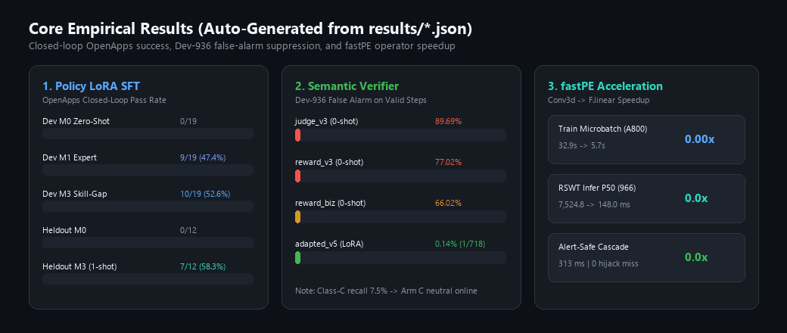
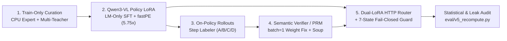

<div align="center">

# GUI-Transition-Verifier

**Post-Training, Transition Verification & Operator Acceleration for Multimodal GUI Agents**

[**English**](README.md) · [**简体中文**](README_CN.md)

<p>
  <a href="https://github.com/ca1tshame/GUI-Transition-Verifier/actions/workflows/ci.yml"></a>
  
  
  
  
  
</p>

<p>
  <a href="#-visual-walkthrough">Demo</a> •
  <a href="#-highlights">Highlights</a> •
  <a href="#-architecture">Architecture</a> •
  <a href="#-benchmarks">Benchmarks</a> •
  <a href="#-quickstart">Quickstart</a> •
  <a href="#-honest-limits--lessons">Honest Limits</a>
</p>

</div>

---

**GUI-Transition-Verifier** is an end-to-end post-training, verification, and inference acceleration suite built around **`Qwen3-VL-8B-Instruct`** for closed-loop desktop GUI agents. Rather than treating policy SFT, step-level process verification, state control, and kernel speedups as disconnected scripts, it unifies them into one reproducible, leakage-isolated pipeline.

> **Companion Project:** [**MiniMind-O Action**](https://github.com/ca1tshame/minimind-o-action) — explores the opposite **lightweight** regime: pretraining a **63.9M Dense LM from scratch** (`3.61B` tokens) + frozen SigLIP2 (`5/6-Tile Focus Crop`) for resource-constrained BrowserGym & OpenApps control.

---

## 🎬 Visual Walkthrough

<table>
  <tr>
    <td align="center" width="52%">
      <br/>
      <sub><b>Closed-Loop Dual-LoRA + 7-State Flow</b> — single <code>Qwen3-VL-8B</code> base serving Policy &amp; Verifier adapters with <code>fastPE</code></sub>
    </td>
    <td align="center" width="48%">
      <br/>
      <sub><b>Core Empirical Results</b> — generated directly from <code>results/*.json</code> (Policy SFT, Verifier FP reduction, <code>fastPE</code>)</sub>
    </td>
  </tr>
</table>

---

## ✨ Highlights

* **🎯 Closed-Loop Policy LoRA SFT (`policy/`)**: Curates `4,534` train-only trajectories (filtering short/noisy teacher fragments and filling skill gaps with zero task/episode/frame overlap), lifting `Qwen3-VL-8B` on OpenApps Dev from `0/19 →` **`10/19 (52.63%)`** and one-shot frozen Heldout from `0/12 →` **`7/12 (58.33%, McNemar p=0.0156)`**.
* **🛡️ Safety & Cross-Domain Verification (`training/`, `policy/`)**: Fixes `batch=1` class-weight cancellation and introduces cross-term-free `Adapter Soup`, lifting 5-class RSWT Macro-F1 from `47.09% →` **`68.77%`** (`0/265` benign false alarms). Adapted to OpenApps Dev-936, it cuts valid-progress false alarms from `66%–90% →` **`0.14%` (`1/718`)**.
* **⚡ `fastPE` Operator & Cascade Acceleration (`fastpe/`)**: Replaces Qwen3-VL's non-overlapping 3D patch `nn.Conv3d` with parameter-shared `F.linear`, delivering **`5.75×`** training microbatch speedup (`grad_cos_sim=0.9768`) and **`50.8×`** P50 safety inference speedup (`7,524.8 → 148.0 ms`), or **`24.12×`** under an Alert-Safe Cascade with **zero missed hijack alerts**.
* **🔬 Rigorous Ablations & Honest Science (`eval/`, `tests/`)**: Ships **`51` CPU unit tests**, 3-layer SHA-256 + `dHash+gray32` leakage guards, and `eval/v5_recompute.py` to independently verify all CIs, McNemar `p`-values, and confusion matrices—including negative results where online Verifier feedback did not improve task success.

---

## 🏗️ Architecture



<details>
<summary><b>Package Layout (8 modules, 51 CPU tests)</b></summary>

| Package | Responsibility |
| --- | --- |
| [`policy/`](policy/) | LM-only Policy LoRA SFT, step-level `A/B/C/D` labeler, 4-class Verifier SFT, single-base Dual-LoRA router, and 3-arm OpenApps evaluator |
| [`training/`](training/) | Effective-number class weights with `batch=1` fix, unilateral positive margin loss, and cross-term-free rank-concatenated LoRA merging (`adapter_soup`) |
| [`prm/`](prm/) | Single-token `ABCD` / `AB` logit scoring and fail-closed 7-state idempotent controller with stale-action guard (`24/24` controlled tasks) |
| [`fastpe/`](fastpe/) | Reversible `Conv3d → F.linear` vision patch projection (`FastPatchEmbed`), two-stage `CascadeRunner`, and latency/numerical parity CLI |
| [`protocols/`](protocols/) | Versioned `<tool_call>` schema, fail-closed parser, and single `[0, 1000]^2` coordinate scaling (`0/80 → 59/80` unpaired MiniWoB++) |
| [`diagnostics/`](diagnostics/) | 144-module per-layer LoRA gradient cosine conflict probe and selective abstention / calibration audits |
| [`eval/`](eval/) &amp; [`results/`](results/) | 3-layer exact + `dHash+gray32` leakage guard, Wilson/McNemar suite, anonymized JSON summaries, and `v5_recompute.py` |
| [`tools/`](tools/) &amp; [`tests/`](tests/) | Pre-publication hygiene scanner (`audit_repo.py`) and `51` CPU unit/regression tests |

</details>

---

## 📊 Benchmarks

### 1. OpenApps Policy Post-Training (Closed-Loop, `1024×576`, `max_steps=25`)

| Split &amp; Policy | Train Mix | Whole-Task Pass | Official Subtasks | 95% Wilson CI | Key Takeaway |
| --- | --- | --- | --- | --- | --- |
| **Dev-19** `M0 Zero-Shot` | — | `0/19` (`0.00%`) | `0/55` | `[0.00%, 16.82%]` | Base model fails zero-shot |
| **Dev-19** `M1 Ep2` | `3,103` expert | `9/19` (`47.37%`) | `34/55` (`61.82%`) | `[27.33%, 68.29%]` | Offline NLL ↑ (`0.167→0.219`) while online ↑ (`2/19→9/19`) |
| **Dev-19** `M3 Ep2` (**Best**) | `4,534` skill-gap | **`10/19` (`52.63%`)** | **`37/55` (`67.27%`)** | `[31.71%, 72.67%]` | Solves both `DeleteToDo` gap tasks; `p=0.0020` vs `M0` |
| **Heldout-12** `M0 Zero-Shot` | — | `0/12` (`0.00%`) | `1/36` (`2.78%`) | `[0.00%, 24.25%]` | Strictly frozen 1-shot baseline |
| **Heldout-12** `Arm A (M3 Ep2)` | `4,534` skill-gap | **`7/12` (`58.33%`)** | **`27/36` (`75.00%`)** | `[31.95%, 80.67%]` | **Zero tuning**, paired exact McNemar **`p=0.0156`** vs `M0` |

### 2. Semantic Verifier, Safety &amp; `fastPE` Speedup

| Task / Benchmark | Baseline | Ours (`adapted_v5` / `fastPE`) | Headline Impact &amp; Caveat |
| --- | --- | --- | --- |
| **RSWT 5-Class Safety (966 Test)** | Zero-shot `47.09%` Macro-F1 | **`68.77%`** (`SOUP-AE`) | `0/265` benign false alarms; `batch=1` weight fix + cross-term-free merge |
| **OpenApps Dev-936 Verifier** | MiniWoB 0-shot FP `66%–90%` | **`0.14%` FP (`1/718`)**, `0.451` F1 | Class-B recall `88.37%`; **Class-C recall `7.50%`** → Arm C neutral online |
| **Controlled PRM &amp; Guard** | Uncalibrated loop | **PRM `81.04%` F1**, **`24/24`** loop | 7-state non-idempotent guard blocks repeated/stale actions |
| **`fastPE` Policy Train (A800)** | `Conv3d` `32.91s` / microbatch | **`5.73s` (`5.75×`)** | `grad_cos_sim=0.976824`; PatchEmbed `13,516.7 → 2.46 ms` |
| **`fastPE` Safety Infer (966)** | `Conv3d` P50 `7,524.8 ms` | **`148.0 ms` (`50.8×`)** | Alert-Safe Cascade (`p1 ∈ [0.30, 0.75]`): **`24.12×`** &amp; **0 missed hijacks** |

<details>
<summary><b>Detailed Ablations: Epoch × Data Quality, 3-Arm Online Eval, Dev-936 Matrix &amp; BF16 Parity</b></summary>

* **Offline NLL vs. Closed-Loop Execution**: `dev_m1_ep1` (`NLL 0.1666`) passes only `2/19` online vs. `dev_m1_ep2` (`NLL 0.2190`) at `9/19` (`McNemar p=0.0156`) because Ep1 under-converges on final submit clicks. Conversely, `M2` (`2,877` expert + `226` visual teacher) peaks at Ep1 (`8/19`) and drops to `3/19` at Ep2 alongside form-abandonment events (`4` vs `0` for `M1`). Filtering short/1080p teacher fragments (`209` dropped) and adding `1,196` Train-only skill-gap episodes yields `M3 Ep2` (`10/19`, `[0,1000]^2` click L2 `37.17` for M1 vs `74.20` for M2 on `n=139` matched clicks).
* **3-Arm Controlled Online Evaluation (`tau_c=0.65, tau_b=0.65`, zero Dev/Heldout tuning)**:
  * Dev-19: `Arm A (policy)` `10/19` | `Arm B (+rules)` `10/19` | `Arm C (+verifier)` `10/19` (`383` verifier calls, `0` interventions, `+0.76s/step`).
  * Heldout-12: `Arm A` `7/12` | `Arm B` `7/12` | `Arm C` `6/12` (`p=1.0`, `0` verifier interventions on the 1 diverged task—step-6 dock variance under dual-LoRA runtime).
* **BF16 Numerical Parity (`results/performance_benchmarks.json`)**: `FastPatchEmbed` is exact in FP64 (`<1e-12`) and shows 1 BF16 ULP forward max diff (`0.007812`, `mean_abs=0.0`). On greedy policy inference (`n=20`), it runs **`2.21×`** faster end-to-end (`6.64s → 3.01s`) with `20/20` action-type match and `18/20` exact raw match (`coord_l2_mean=5.116`). Full-Parity Cascade (`+ conf < 0.70`) achieves `4.62×` speedup with `0/966` argmax flips.
* **Calibration &amp; Leakage Audits**: `eval/leak_guard.py` filters `62.51%` near-duplicates in `frozen_v1`; `diagnostics/gradient_conflict.py` probes `144` LoRA modules (`-0.8018` Class-4 opposition at layer 28); `diagnostics/selective_abstention.py` documents Temperature Scaling flipping `15/22` cross-sample `p1` ROC-AUC pairs vs. strictly monotonic Platt scaling.

</details>

---

## 🚀 Quickstart

### 1. Verify Everything on CPU (~5 Seconds, No GPU Required)

```bash
git clone https://github.com/ca1tshame/GUI-Transition-Verifier.git
cd GUI-Transition-Verifier
python -m venv .venv
# Windows: .venv\Scripts\activate   |   POSIX: source .venv/bin/activate
pip install -r requirements.txt

python -B tools/audit_repo.py                  # Repo hygiene & leakage-safety audit
python -B -m pytest -p no:cacheprovider -v     # All 51 CPU unit & regression tests
python -B -m eval.v5_recompute                 # Recompute Wilson CIs, McNemar p & Verifier F1
```

<details>
<summary><b>2. Full GPU Training, Dual-LoRA Serving &amp; 3-Arm OpenApps Evaluation</b></summary>

Requires local `Qwen/Qwen3-VL-8B-Instruct` weights, `pip install ".[all]"`, and an external Playwright + BrowserGym + OpenApps setup.

```bash
# Policy LoRA SFT (M3)
python -B -m policy.train_policy_sft --model-path /path/to/Qwen3-VL-8B-Instruct \
  --split /path/to/train.jsonl --manifest /path/to/manifest.json \
  --prompt-config /path/to/prompt_cfg.json --output-dir runs/m3_policy

# Semantic Verifier LoRA SFT (micro_batch_size=1 for M-RoPE parity)
python -B -m policy.train_verifier_sft --model-path /path/to/Qwen3-VL-8B-Instruct \
  --v-train /path/to/v_train.jsonl --v-val /path/to/v_val.jsonl --output-dir runs/verifier_v5

# Single-base Dual-LoRA server & closed-loop 3-arm evaluation
python -B -m policy.dual_lora_router --model-path /path/to/Qwen3-VL-8B-Instruct \
  --prompt-config /path/to/prompt_cfg.json --policy-adapter runs/m3_policy/final_adapter \
  --verifier-adapter runs/verifier_v5/best_adapter --port 39850
python -B -m policy.eval_openapps --run-tag heldout_arm_c --split heldout --mode verifier \
  --api-url <SERVER_URL> --task-freeze-json /path/to/openapps_task_freeze.json \
  --tasks-yaml /path/to/longer_horizon.yaml --output-dir runs/eval --confirm-one-shot-heldout
```

</details>

---

## 🔍 Honest Limits & Lessons

We explicitly report negative results and statistical boundaries alongside gains:

1. **Why Online Verifier (`Arm C`) Did Not Beat Pure Policy**: Although `adapted_v5` cuts valid-progress false alarms to `0.14%`, its semantic-error Class-C recall is only **`7.50%` (`12/160`)**. Post-hoc audit of `policy/train_verifier_sft.py` proved that PyTorch's `F.cross_entropy(..., weight=cls_weights)` under `micro_batch_size=1` mathematically cancels class weights (`w_y * nll / w_y = nll`), even with gradient accumulation. Fixing this via `training/losses.py` for 4-class OpenApps remains an open retraining experiment.
2. **Small-Sample Statistical Bounds**: Dev (`n=19`) and one-shot Heldout (`n=12`) carry wide 95% Wilson CIs (`> ±20 pp`), supporting significant improvement over zero-shot `M0` (`p=0.0156` / `p=0.0020`) rather than `±1`-task claims.
3. **BF16 Reduction-Order Drift**: `FastPatchEmbed` is algebraically exact in FP64 (`<1e-12`) but has minor BF16 reduction drift (`15/966` RSWT argmax flips; `18/20` exact raw policy match), motivating the empirical `CascadeRunner` fallback gates.
4. **Licensing & Withheld Assets**: Original source code is **Apache-2.0** ([`LICENSE`](LICENSE)). No checkpoints, screenshots, or third-party benchmarks are redistributed (`OpenApps` is **CC BY-NC 4.0**; `Qwen3-VL-8B-Instruct` follows its upstream license).
