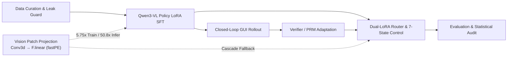

<div align="center">

# GUI Agent Post-Training

**Qwen3-VL Policy Learning, Process Verification & Efficient Inference**

[**English**](README.md) · [**简体中文**](README_CN.md)

<p>
  <a href="https://github.com/ca1tshame/gui-agent-posttraining/actions/workflows/ci.yml"></a>
  
  
  
  
</p>

<p>
  <a href="#visual-overview">Overview</a> •
  <a href="#key-highlights">Highlights</a> •
  <a href="#architecture">Architecture</a> •
  <a href="#selected-results">Results</a> •
  <a href="#quickstart">Quickstart</a> •
  <a href="#documentation">Documentation</a>
</p>

</div>

---

An end-to-end post-training, transition verification, and operator-acceleration codebase built around **`Qwen3-VL-8B-Instruct`** for closed-loop desktop GUI agents *(previously developed under `GUI-Transition-Verifier`)*.

> **Companion Project:** [**MiniMind-O Action**](https://github.com/ca1tshame/minimind-o-action) — explores the complementary lightweight side with a **63.9M from-scratch language backbone** (`3.61B` tokens) + frozen SigLIP2 (`5/6-Tile Focus Crop`).

---

## Visual Overview

<p align="center">
  
</p>

> *Figure above summarizes verified metrics from [`results/`](results/) (under separate evaluation configurations; not a live rollout recording). Live OpenApps rollout GIFs can be assembled directly from cluster episode traces via [`tools/record_openapps_gif.py`](tools/record_openapps_gif.py).*

---

## Key Highlights

* **Closed-Loop Policy Post-Training**: Curates `4,534` leakage-isolated multi-app trajectories (task/episode split + perceptual image deduplication) for LM-only LoRA SFT on `Qwen3-VL-8B`, lifting OpenApps Dev from `0/19 →` **`10/19 (52.63%)`** and one-shot frozen Heldout from `0/12 →` **`7/12 (58.33%, p=0.016)`**.
* **Safety Verification & Process Reward Modeling**: Fixes `batch=1` class-weight cancellation and introduces cross-term-free `Adapter Soup`, lifting 5-class RSWT Macro-F1 from `47.09% →` **`68.77%`** (`0/265` benign false alarms); trains a 4-class PRM (`81.04%` Macro-F1) and adapts transition verification to OpenApps (`0.14%` valid-step false alarm).
* **Single-Base Dual-LoRA Routing & Fail-Closed Control**: Serves co-resident Policy and Verifier adapters on one frozen `Qwen3-VL-8B` backbone paired with a 7-state non-idempotent guard (`24/24` controlled multi-step tasks).
* **`fastPE` Operator & Cascade Acceleration**: Rewrites non-overlapping 3D patch `nn.Conv3d` as algebraic-equivalent `F.linear`, delivering **`5.75×`** training microbatch speedup and **`50.8×`** P50 safety inference speedup (`24.12×` under an Alert-Safe Cascade with zero missed hijack alerts).

---

## Architecture



---

## Selected Results

| Benchmark / Capability | Baseline | Ours | Scope &amp; Key Qualifier |
| --- | --- | --- | --- |
| **OpenApps Dev (`n=19`)** | `0/19` (`0.00%`) | **`10/19` (`52.63%`)** | `37/55` official subtasks; paired `McNemar p=0.0020` vs `M0` |
| **OpenApps Frozen Heldout (`n=12`)** | `0/12` (`0.00%`) | **`7/12` (`58.33%`)** | One-shot run (`0` test tuning), `p=0.016` vs `M0`; small `n=12` sample |
| **RSWT 5-Class Safety (`n=966`)** | `47.09%` Macro-F1 | **`68.77%` Macro-F1** | `Adapter Soup`; `0/265` benign false alarms |
| **OpenApps Transition Verifier (`n=936`)** | `66%–90%` valid-step FP | **`0.14%` valid-step FP** | Valid-progress steps only; low Class-C recall (`7.5%`) &amp; neutral online Arm C (see [Limitations](docs/LIMITATIONS.md)) |
| **`fastPE` (`Conv3d → F.linear`)** | `32.91s` train / `7,524.8 ms` P50 | **`5.75×` train / `50.8×` P50** | Separate policy-train (`grad_cos_sim=0.9768`) and RSWT-infer configs; Alert-Safe Cascade `24.12×` |

---

## Quickstart

CPU unit tests and statistical recomputation run out-of-the-box in ~5 seconds (no GPU or checkpoints required):

```bash
git clone https://github.com/ca1tshame/gui-agent-posttraining.git
cd gui-agent-posttraining
python -m venv .venv
# Windows: .venv\Scripts\activate   |   POSIX: source .venv/bin/activate
pip install -r requirements.txt

python -B tools/audit_repo.py                  # Repo hygiene & leakage-safety audit
python -B -m pytest -p no:cacheprovider -v     # CPU unit & regression tests
python -B -m eval.v5_recompute                 # Recompute Wilson CIs, McNemar p & F1 from results/
```

> GPU training, Dual-LoRA serving, and live OpenApps evaluation require local `Qwen/Qwen3-VL-8B-Instruct` weights (`pip install ".[all]"`) and an external Playwright + BrowserGym + OpenApps setup; full commands are documented in [`docs/EXPERIMENTS.md`](docs/EXPERIMENTS.md).

---

## Documentation

- [`docs/EXPERIMENTS.md`](docs/EXPERIMENTS.md): Full epoch/data ablations, 3-arm online tables, Dev-936 confusion matrices, `fastPE` parity benchmarks, and GPU launch commands.
- [`docs/LIMITATIONS.md`](docs/LIMITATIONS.md): Root-cause audit of `batch=1` class-weight cancellation, online Verifier neutrality, small-sample Wilson CIs, BF16 numerical drift, and licensing boundaries.
- [`results/`](results/): Anonymized benchmark JSON summaries verified by [`eval/v5_recompute.py`](eval/v5_recompute.py).

**License:** Apache-2.0 ([`LICENSE`](LICENSE)). Model weights and screenshots are not redistributed; OpenApps experiments are subject to CC BY-NC 4.0.
