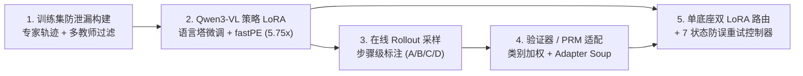

<div align="center">

# GUI-Transition-Verifier

**面向多模态 GUI Agent 的策略后训练、状态转移验证与算子推理加速**

[**English**](README.md) · [**简体中文**](README_CN.md)

<p>
  <a href="https://github.com/ca1tshame/GUI-Transition-Verifier/actions/workflows/ci.yml"></a>
  
  
  
  
  
</p>

<p>
  <a href="#-动态演示">动态演示</a> •
  <a href="#-核心亮点">核心亮点</a> •
  <a href="#-系统架构">系统架构</a> •
  <a href="#-核心实验结果">实验结果</a> •
  <a href="#-快速开始">快速开始</a> •
  <a href="#-范围说明与开源协议">范围与协议</a>
</p>

</div>

---

**GUI-Transition-Verifier** 是一套围绕 **`Qwen3-VL-8B-Instruct`** 打造的多模态桌面 GUI Agent 端到端后训练与推理加速系统，将**防泄漏策略 LoRA 微调、跨环境状态验证与过程奖励建模（PRM）、7 状态防误重试控制**以及 **`Conv3d → F.linear` 视觉算子加速（`fastPE`）**整合为可复现工程管线。

> **姊妹仓库：** [**MiniMind-O Action**](https://github.com/ca1tshame/minimind-o-action) —— 探索互补的**端侧轻量级**方向：从零预训练 **63.9M Dense 主干**（`3.61B` tokens）+ 冻结 SigLIP2（`5/6-Tile` 局部高清裁剪），验证轻量模型在 BrowserGym 与 OpenApps 闭环交互中的能力边界。

---

## 🎬 动态演示

<table>
  <tr>
    <td align="center" width="52%">
      <br/>
      <sub><b>单底座双 LoRA 闭环流程（架构示意）</b> — 同一 <code>Qwen3-VL-8B</code> 底座动态切换 Policy / Verifier LoRA，结合 <code>fastPE</code> 与 7 状态控制</sub>
    </td>
    <td align="center" width="48%">
      <br/>
      <sub><b>核心实证结果总览</b> — 直接读取仓库 <code>results/*.json</code> 自动生成（策略 SFT、误报抑制与 <code>fastPE</code> 加速）</sub>
    </td>
  </tr>
</table>

---

## ✨ 核心亮点

* **🎯 闭环策略后训练（`policy/`）**：构建 `4,534` 条严格防泄漏的多应用轨迹训练集（三层精确匹配 + 图像感知哈希隔离），将 `Qwen3-VL-8B` 在 OpenApps Dev 的在线成功率从 `0/19` 提升至 **`10/19（52.63%）`**，一次性冻结测试集（Heldout）从 `0/12` 提升至 **`7/12（58.33%，p=0.0156）`**。
* **🛡️ 状态安全验证与过程控制（`training/`, `prm/`）**：通过样本级类别加权与无交叉项 `Adapter Soup` 融合，将五分类 RSWT 安全测试集 Macro-F1 从 `47.09%` 提升至 **`68.77%`**（良性误报 **`0/265`**）；迁移至 OpenApps Dev-936 将有效进展步骤误报率从 `66%–90%` 压降至 **`0.14%`**，配合四分类 PRM（Macro-F1 **`81.04%`**）与 7 状态控制器实现受控闭环 **`24/24`**。
* **⚡ `fastPE` 算子重写与级联推理（`fastpe/`）**：将视觉 Patch Embedding 的 `nn.Conv3d` 重写为代数等价的 `F.linear`，实现训练微批 **`5.75×`** 加速（梯度余弦相似度 `0.9768`）与安全推理 P50 **`50.8×`** 加速（`7,524.8 → 148.0 ms`）；配合置信度 BF16 级联回退实现 **`24.12×`** 加速且高危劫持 **零漏报**。
* **🔬 可复算的统计与测试套件（`eval/`, `tests/`）**：提供 **`51` 项 CPU 单元测试**、防泄漏审计工具以及 `eval/v5_recompute.py`，可在无 GPU 环境下 5 秒内复算 [`results/`](results/) 中的全部置信区间、McNemar `p` 值与混淆矩阵。

---

## 🏗️ 系统架构



<details>
<summary><b>核心目录与模块说明（8 个包，51 项 CPU 测试）</b></summary>

| 目录 | 核心职责 |
| --- | --- |
| [`policy/`](policy/) | `Qwen3-VL` 语言塔 LoRA 策略微调、步骤级 `A/B/C/D` 标注、Verifier 微调、单底座双 LoRA HTTP 路由与三臂评测 |
| [`training/`](training/) | `batch=1` 样本级加权修复、单边正样本 Margin Loss 与无交叉项秩拼接 `Adapter Soup` 融合 |
| [`prm/`](prm/) | 单 Token `ABCD`/`AB` 末位 Logit 评分与 7 状态非幂等防误重试控制器 |
| [`fastpe/`](fastpe/) | 可逆 `Conv3d → F.linear` Patch Embedding（`FastPatchEmbed`）、两阶段 `CascadeRunner` 级联与对齐基准脚本 |
| [`protocols/`](protocols/) | 版本化 `<tool_call>` 解析器与统一 `[0, 1000]^2` 坐标映射 |
| [`diagnostics/`](diagnostics/) | 144 模块逐层 LoRA 梯度冲突探测与选择性拒识 / 概率校准分析 |
| [`eval/`](eval/) &amp; [`results/`](results/) | 三层精确+`dHash+gray32` 隔离卫士、统计检验库与 `v5_recompute.py` 一键复算 |
| [`tools/`](tools/) &amp; [`tests/`](tests/) | 发布前规范扫描（`audit_repo.py`）及 `51` 项 CPU 单元测试 |

</details>

---

## 📊 核心实验结果

### 1. OpenApps 策略后训练闭环评测（`1024×576`）

| 评测集与模型 | 训练数据 | 整局成功率 | 官方子任务 | 95% Wilson CI |
| --- | --- | --- | --- | --- |
| **Dev-19** `M0 零样本` | — | `0/19` (`0.00%`) | `0/55` | `[0.00%, 16.82%]` |
| **Dev-19** `M1 专家轨迹 Ep2` | `3,103` 条 | `9/19` (`47.37%`) | `34/55` (`61.82%`) | `[27.33%, 68.29%]` |
| **Dev-19** `M3 技能补齐 Ep2`（**最佳**） | `4,534` 条 | **`10/19` (`52.63%`)** | **`37/55` (`67.27%`)** | `[31.71%, 72.67%]` |
| **Heldout-12** `M0 零样本` | — | `0/12` (`0.00%`) | `1/36` (`2.78%`) | `[0.00%, 24.25%]` |
| **Heldout-12** `M3 Ep2`（**一次性冻结**） | `4,534` 条 | **`7/12` (`58.33%`)** | **`27/36` (`75.00%`)** | `[31.95%, 80.67%]` |

> 相比零样本 `M0` 基线，配对精确 McNemar 检验在 Dev-19 上 **`p = 0.0020`**，在零调参一次性冻结 Heldout-12 上 **`p = 0.0156`**。

### 2. 安全验证、过程控制与 `fastPE` 加速

| 任务 / 评测集 | 基线 | 本仓库方案 | 核心指标 |
| --- | --- | --- | --- |
| **RSWT 五分类安全测试（966 条）** | 零样本 `47.09%` F1 | **`68.77%` Macro-F1** | `SOUP-AE` 融合；良性误报 **`0/265`** |
| **OpenApps Dev-936 过程验证** | 零样本误报 `66%–90%` | **误报 `0.14%`（`1/718`）** | 有效步骤误报大幅抑制；停滞类召回 `88.37%` |
| **协议对齐与 PRM 控制** | 历史 `0/80` | **MiniWoB `59/80`**，闭环 **`24/24`** | PRM `81.04%` Macro-F1 + 7 状态防误重试 |
| **`fastPE` 策略训练（A800）** | `Conv3d` `32.91s` / 微批 | **`5.73s` (`5.75×`)** | `grad_cos_sim = 0.9768`；贪婪推理 `2.21×`（动作类型 `20/20` 一致） |
| **`fastPE` 安全推理（966 条）** | `Conv3d` P50 `7,524.8 ms` | **`148.0 ms` (`50.8×`)** | Alert-Safe 级联：**`24.12×`** 且高危劫持 **零漏报** |

---

## 🚀 快速开始

```bash
git clone https://github.com/ca1tshame/GUI-Transition-Verifier.git
cd GUI-Transition-Verifier
python -m venv .venv
# Windows: .venv\Scripts\activate   |   Linux/macOS: source .venv/bin/activate
pip install -r requirements.txt

python -B tools/audit_repo.py                  # 仓库规范与防泄漏检查
python -B -m pytest -p no:cacheprovider -v     # 运行全部 51 项 CPU 单元测试
python -B -m eval.v5_recompute                 # 从 results/ 一键复算 CI、McNemar p 与 F1
```

<details>
<summary><b>完整 GPU 微调、单底座双 LoRA 服务与闭环评测命令</b></summary>

需本地准备 `Qwen/Qwen3-VL-8B-Instruct` 权重、`pip install ".[all]"` 及外部 Playwright + BrowserGym + OpenApps 环境。

```bash
# 1. 策略 LoRA 微调 (M3)
python -B -m policy.train_policy_sft --model-path /path/to/Qwen3-VL-8B-Instruct \
  --split /path/to/train.jsonl --manifest /path/to/manifest.json \
  --prompt-config /path/to/prompt_cfg.json --output-dir runs/m3_policy

# 2. 过程验证器 LoRA 微调
python -B -m policy.train_verifier_sft --model-path /path/to/Qwen3-VL-8B-Instruct \
  --v-train /path/to/v_train.jsonl --v-val /path/to/v_val.jsonl --output-dir runs/verifier_v5

# 3. 单底座双 LoRA 路由与三臂闭环评测
python -B -m policy.dual_lora_router --model-path /path/to/Qwen3-VL-8B-Instruct \
  --prompt-config /path/to/prompt_cfg.json --policy-adapter runs/m3_policy/final_adapter \
  --verifier-adapter runs/verifier_v5/best_adapter --port 39850
python -B -m policy.eval_openapps --run-tag heldout_arm_c --split heldout --mode verifier \
  --api-url <SERVER_URL> --task-freeze-json /path/to/openapps_task_freeze.json \
  --tasks-yaml /path/to/longer_horizon.yaml --output-dir runs/eval --confirm-one-shot-heldout
```

</details>

---

## 📦 范围说明与开源协议

* **实验范围与后续规划**：三臂在线消融原始数据及 `training/losses.py` 中的 `batch=1` 样本加权修复已完整归档于 [`results/`](results/) 供复现检验；后续将把该样本加权机制迁移至四分类 OpenApps 验证器重训，以进一步提升语义错类的在线召回与干预收益。
* **协议与资产说明**：本仓库原始代码采用 **Apache-2.0** 协议（[`LICENSE`](LICENSE)），不包含模型权重、界面截图及第三方评测集源码（OpenApps 遵循 **CC BY-NC 4.0**）。
