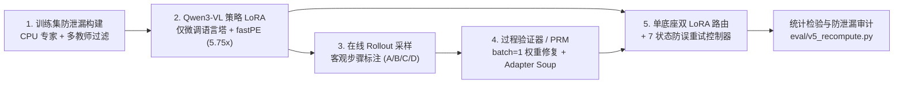

<div align="center">

# GUI-Transition-Verifier

**面向多模态 GUI Agent 的策略后训练、状态转移验证与算子推理加速**

[**English**](README.md) · [**简体中文**](README_CN.md)

<p>
  <a href="https://github.com/ca1tshame/GUI-Transition-Verifier/actions/workflows/ci.yml"></a>
  
  
  
  
  
</p>

<p>
  <a href="#-动态演示">动态演示</a> •
  <a href="#-核心亮点">核心亮点</a> •
  <a href="#-系统架构">系统架构</a> •
  <a href="#-核心实验结果">实验结果</a> •
  <a href="#-快速开始">快速开始</a> •
  <a href="#-诚实边界与复盘">诚实复盘</a>
</p>

</div>

---

**GUI-Transition-Verifier** 是一套围绕 **`Qwen3-VL-8B-Instruct`** 打造的多模态桌面 GUI Agent 端到端算法与工程系统，打通了**防泄漏策略后训练、跨环境过程验证（PRM / Verifier）、7 状态防误重试控制**与 **`Conv3d → F.linear` 视觉算子加速（`fastPE`）**全链路。

> **姊妹仓库：** [**MiniMind-O Action**](https://github.com/ca1tshame/minimind-o-action) —— 探索相反的**端侧轻量级**方向：从随机初始化预训练 **63.9M Dense 语言主干**（`3.61B` tokens）+ 冻结 SigLIP2（`5/6-Tile` 局部高清裁剪），验证小模型在 BrowserGym 与 OpenApps 闭环控制中的能力边界。

---

## 🎬 动态演示

<table>
  <tr>
    <td align="center" width="52%">
      <br/>
      <sub><b>单底座双 LoRA 闭环流程（架构示意）</b> — 同一 <code>Qwen3-VL-8B</code> 底座动态切换 Policy / Verifier LoRA，结合 <code>fastPE</code> 与 7 状态控制</sub>
    </td>
    <td align="center" width="48%">
      <br/>
      <sub><b>核心实证结果总览</b> — 直接读取仓库 <code>results/*.json</code> 自动生成（策略 SFT、误报抑制与 <code>fastPE</code> 加速）</sub>
    </td>
  </tr>
</table>

---

## ✨ 核心亮点

* **🎯 闭环策略 LoRA 后训练（`policy/`）**：严格隔离训练/评测集，构建 `4,534` 条高质量多应用轨迹（过滤短程噪声教师片段、补齐薄弱技能），将 `Qwen3-VL-8B` 在 OpenApps Dev 的在线成功率从 `0/19` 提升至 **`10/19（52.63%）`**，一次性冻结测试集（Heldout）从 `0/12` 提升至 **`7/12（58.33%，配对精确 McNemar p=0.0156）`**。
* **🛡️ 安全校验与跨环境过程验证（`training/`, `policy/`）**：修复 `batch=1` 下 PyTorch `CrossEntropyLoss` 类别权重数学抵消问题，并提出无交叉项 `Adapter Soup` 融合，将五分类 RSWT 安全测试集 Macro-F1 从 `47.09%` 提升至 **`68.77%`**（良性误报 **`0/265`**）；迁移至 OpenApps Dev-936 后，将正常进展步骤的误报率从 `66%–90%` 降至 **`0.14%`（`1/718`）**。
* **⚡ `fastPE` 视觉算子重写与级联推理（`fastpe/`）**：基于 PyTorch Profiler 定位视觉 Patch Embedding 的 `Conv3d` 瓶颈并重写为数学等价的 `F.linear`，实现训练微批 **`5.75×`** 加速（梯度余弦相似度 `0.9768`）与安全推理 P50 **`50.8×`** 加速（`7,524.8 → 148.0 ms`）；配合置信度 BF16 级联回退，在 **`24.12×`** 加速下保持高危劫持 **零漏报**。
* **🔬 完备的单测与防泄漏审计（`eval/`, `tests/`）**：内置 **`51` 项 CPU 单元测试**、三层精确+图像感知哈希防泄漏隔离，以及 `eval/v5_recompute.py` 一键复算全部置信区间、McNemar `p` 值与混淆矩阵——同时**如实记录负实验**（如在线 Verifier 未带来整局提点及其根因定位）。

---

## 🏗️ 系统架构



<details>
<summary><b>核心目录与模块说明（8 个包，51 项 CPU 测试）</b></summary>

| 目录 | 核心职责 |
| --- | --- |
| [`policy/`](policy/) | `Qwen3-VL` 语言塔 LoRA 策略微调、步骤级 `A/B/C/D` 标注、四分类 Verifier 微调、单底座双 LoRA HTTP 路由与三臂评测 |
| [`training/`](training/) | `batch=1` 样本级加权修复、单边正样本 Margin Loss 与无交叉项秩拼接 `Adapter Soup` 融合 |
| [`prm/`](prm/) | 单 Token `ABCD`/`AB` 末位 Logit 评分与 7 状态非幂等防误重试控制器（受控多步闭环 `24/24`） |
| [`fastpe/`](fastpe/) | 可逆 `Conv3d → F.linear` Patch Embedding（`FastPatchEmbed`）、两阶段 `CascadeRunner` 级联与数值对齐基准脚本 |
| [`protocols/`](protocols/) | 版本化 `<tool_call>` 解析器与单次 `[0, 1000]^2` 坐标映射（MiniWoB++ V2 达 `59/80`） |
| [`diagnostics/`](diagnostics/) | 144 模块逐层 LoRA 梯度冲突探测与选择性拒识（Abstention）/ 概率校准分析 |
| [`eval/`](eval/) &amp; [`results/`](results/) | 三层精确+`dHash+gray32` 隔离卫士、Wilson CI/McNemar 统计库、匿名化结果 JSON 与复算脚本 |
| [`tools/`](tools/) &amp; [`tests/`](tests/) | 发布前仓库合规与敏感信息扫描（`audit_repo.py`）及 `51` 项 CPU 单元测试 |

</details>

---

## 📊 核心实验结果

### 1. OpenApps 策略后训练闭环评测（`1024×576`，`max_steps=25`）

| 数据集与模型 | 训练数据 | 整局成功率 | 官方子任务 | 95% Wilson CI | 核心结论 |
| --- | --- | --- | --- | --- | --- |
| **Dev-19** `M0 零样本` | — | `0/19` (`0.00%`) | `0/55` | `[0.00%, 16.82%]` | 开源基座零样本几乎完全失效 |
| **Dev-19** `M1 Ep2` | `3,103` 专家轨迹 | `9/19` (`47.37%`) | `34/55` (`61.82%`) | `[27.33%, 68.29%]` | 离线 NLL 升高（`0.167→0.219`）但在线率大涨（`2/19→9/19`） |
| **Dev-19** `M3 Ep2`（**最佳**） | `4,534` 技能补齐 | **`10/19` (`52.63%`)** | **`37/55` (`67.27%`)** | `[31.71%, 72.67%]` | 攻克此前 `0%` 的删待办类任务；vs `M0` `p=0.0020` |
| **Heldout-12** `M0 零样本` | — | `0/12` (`0.00%`) | `1/36` (`2.78%`) | `[0.00%, 24.25%]` | 一次性冻结测试基线 |
| **Heldout-12** `Arm A (M3 Ep2)` | `4,534` 技能补齐 | **`7/12` (`58.33%`)** | **`27/36` (`75.00%`)** | `[31.95%, 80.67%]` | **零测试集调参**，配对精确 McNemar **`p=0.0156`** |

### 2. 状态安全验证、过程奖励与 `fastPE` 加速

| 任务 / 评测集 | 基线 | 本仓库方案 | 核心指标与实证边界 |
| --- | --- | --- | --- |
| **RSWT 五分类安全测试（966 条）** | 零样本 `47.09%` Macro-F1 | **`68.77%`** (`SOUP-AE`) | 良性误报 **`0/265`**；`batch=1` 权重修复 + 无交叉项融合 |
| **OpenApps Dev-936 过程验证** | 跨领域零样本误报 `66%–90%` | **误报 `0.14%`（`1/718`）** | 停滞类召回 `88.37%`；**语义错类召回仅 `7.50%`**（见下文复盘） |
| **受控 PRM 与状态控制** | 无状态保护 | **PRM `81.04%` F1**，闭环 **`24/24`** | 7 状态非幂等控制器拦截重复无效/过期动作 |
| **`fastPE` 策略训练（A800）** | `Conv3d` `32.91s` / 微批 | **`5.73s` (`5.75×`)** | `grad_cos_sim=0.976824`；PatchEmbed `13,516.7 → 2.46 ms` |
| **`fastPE` 安全推理（966 条）** | `Conv3d` P50 `7,524.8 ms` | **`148.0 ms` (`50.8×`)** | Alert-Safe 级联（`p1 ∈ [0.30, 0.75]`）：**`24.12×`** 且 **零高危漏报** |

<details>
<summary><b>展开详细消融：离线 NLL 与在线脱钩、三臂对照评测及 BF16 数值边界</b></summary>

* **离线 NLL 不能代表在线闭环成功率**：`M1 Ep1`（`NLL 0.1666`）在线仅 `2/19`，而 `M1 Ep2`（`NLL 0.2190`）却达 `9/19`（`McNemar p=0.0156`），因为 Ep1 尚未学稳表单最终提交按钮点击。相反，`M2` 混入未经筛选的教师片段后 Ep2 发生表单中途放弃（`4` 次 vs `M1` `0` 次），成功率从 `8/19` 跌至 `3/19`；过滤 `209` 条短程/1080p 噪声片段并补充 `1,196` 条训练集专家补缺轨迹后，`M3 Ep2` 达到 `10/19`。
* **三臂受控在线消融（阈值锁定 `0.65/0.65`，不在 Dev/Heldout 调参）**：
  * Dev-19：`Arm A (纯策略)` `10/19` | `Arm B (+规则)` `10/19` | `Arm C (+Verifier)` `10/19`（调用 `383` 次，`0` 次拦截，`+0.76s/步`）。
  * Heldout-12：`Arm A` `7/12` | `Arm B` `7/12` | `Arm C` `6/12`（`p=1.0`，唯一差异任务上 Verifier 全程 `0` 拦截，源于双 LoRA 运行时第 6 步 Dock 点击波动）。
* **BF16 数值对齐（`results/performance_benchmarks.json`）**：`FastPatchEmbed` 在 FP64 下误差 `<1e-12`；BF16 仅存在累加序差异（前向最大差 `0.007812` = 1 ULP），20 条贪婪推理端到端加速 **`2.21×`**（`6.64s → 3.01s`），动作类型 `20/20` 一致、原始文本 `18/20` 完全一致；Full-Parity 级联门控实现 **`4.62×`** 加速且 `0/966` 预测翻转。

</details>

---

## 🚀 快速开始

### 1. 5 秒本地 CPU 验算（无需 GPU）

```bash
git clone https://github.com/ca1tshame/GUI-Transition-Verifier.git
cd GUI-Transition-Verifier
python -m venv .venv
# Windows: .venv\Scripts\activate   |   Linux/macOS: source .venv/bin/activate
pip install -r requirements.txt

python -B tools/audit_repo.py                  # 仓库隐私与防泄漏规范检查
python -B -m pytest -p no:cacheprovider -v     # 运行全部 51 项 CPU 单元测试
python -B -m eval.v5_recompute                 # 从 results/ 复算全部 CI、McNemar p 与 F1
```

<details>
<summary><b>2. 完整 GPU 微调、双 LoRA 部署与三臂评测命令</b></summary>

需本地准备 `Qwen/Qwen3-VL-8B-Instruct` 权重、`pip install ".[all]"` 及外部 Playwright + BrowserGym + OpenApps 环境。

```bash
# 1. 策略 LoRA 微调 (M3)
python -B -m policy.train_policy_sft --model-path /path/to/Qwen3-VL-8B-Instruct \
  --split /path/to/train.jsonl --manifest /path/to/manifest.json \
  --prompt-config /path/to/prompt_cfg.json --output-dir runs/m3_policy

# 2. 过程验证器 LoRA 微调 (micro_batch_size=1 保证 M-RoPE 一致性)
python -B -m policy.train_verifier_sft --model-path /path/to/Qwen3-VL-8B-Instruct \
  --v-train /path/to/v_train.jsonl --v-val /path/to/v_val.jsonl --output-dir runs/verifier_v5

# 3. 单底座双 LoRA HTTP 服务与三臂闭环评测
python -B -m policy.dual_lora_router --model-path /path/to/Qwen3-VL-8B-Instruct \
  --prompt-config /path/to/prompt_cfg.json --policy-adapter runs/m3_policy/final_adapter \
  --verifier-adapter runs/verifier_v5/best_adapter --port 39850
python -B -m policy.eval_openapps --run-tag heldout_arm_c --split heldout --mode verifier \
  --api-url <SERVER_URL> --task-freeze-json /path/to/openapps_task_freeze.json \
  --tasks-yaml /path/to/longer_horizon.yaml --output-dir runs/eval --confirm-one-shot-heldout
```

</details>

---

## 🔍 诚实边界与复盘

本仓库坚持如实披露负实验、小样本置信边界与算子数值误差：

1. **为什么在线 Verifier（`Arm C`）未提升整局成功率**：虽然 `adapted_v5` 将正常步骤误报压低到 `0.14%`，但对语义错误类（Class-C）的召回只有 **`7.50%`（`12/160`）**。事后代码审计 `policy/train_verifier_sft.py` 定位到根本 Bug：`micro_batch_size=1` 时 PyTorch 默认加权平均会将 `F.cross_entropy(..., weight=cls_weights)` 的类别权重在分子分母约掉（`w_y * nll / w_y = nll`），即使梯度累积也无法生效。将 `training/losses.py` 中的 `batch=1` 修复迁移到四分类重训仍待后续消融验证。
2. **小样本统计边界**：Dev（`n=19`）与 Heldout（`n=12`）的 95% Wilson 置信区间均超过 `±20 pp`，足以支持“显著超越零样本基线”，但不能据此夸大单任务 `±1` 的微弱差异。
3. **BF16 累加序漂移**：`FastPatchEmbed` 在 FP64 下严格代数等价（`<1e-12`），在 BF16 下因 GEMM 规约序不同存在极轻微数值漂移（966 条 RSWT 出现 15 次预测翻转），这正是设计两阶段置信度 `CascadeRunner` 回退机制的原因。
4. **开源协议与资产边界**：本仓库原始代码采用 **Apache-2.0** 协议（[`LICENSE`](LICENSE)），不包含模型权重、界面截图及第三方评测集源码（OpenApps 遵循 **CC BY-NC 4.0**）。
