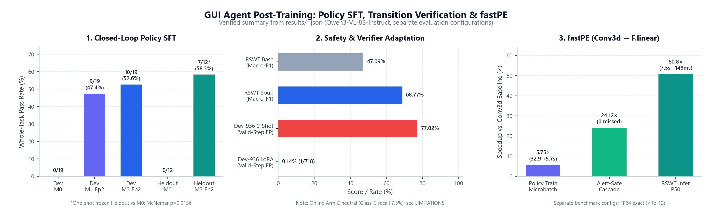
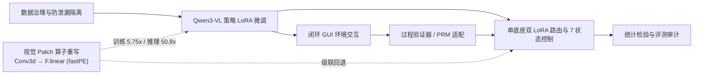

<div align="center">

# GUI Agent Post-Training

**面向 Qwen3-VL 多模态 GUI Agent 的策略后训练、过程验证与算子加速**

[**English**](README.md) · [**简体中文**](README_CN.md)

<p>
  <a href="https://github.com/ca1tshame/gui-agent-posttraining/actions/workflows/ci.yml"></a>
  
  
  
  
</p>

<p>
  <a href="#图表总览">图表总览</a> •
  <a href="#核心技术亮点">核心亮点</a> •
  <a href="#系统架构">系统架构</a> •
  <a href="#核心实验结果">核心结果</a> •
  <a href="#快速开始">快速开始</a> •
  <a href="#文档导航">文档导航</a>
</p>

</div>

---

围绕 **`Qwen3-VL-8B-Instruct`** 打造的多模态桌面 GUI Agent 后训练、状态转移验证与视觉算子加速工程体系 *（原仓库名：`GUI-Transition-Verifier`）*。

> **姊妹仓库：** [**MiniMind-O Action**](https://github.com/ca1tshame/minimind-o-action) —— 探索互补的端侧轻量级路线：从零预训练 **63.9M 语言主干**（`3.61B` tokens）+ 冻结 SigLIP2（`5/6-Tile` 局部高清融合）。

---

## 图表总览

<p align="center">
  
</p>

> *上图汇总了 [`results/`](results/) 中的独立评测结果（不同实验配置分列，非实时交互录像）。当从集群 OpenApps Dev 评测采集到脱敏轨迹帧后，可通过 [`tools/record_openapps_gif.py`](tools/record_openapps_gif.py) 直接生成带动作标注的真实执行 GIF。*

---

## 核心技术亮点

* **闭环策略后训练**：构建 `4,534` 条防泄漏多应用轨迹（按任务/轨迹划分并结合图像哈希去重），仅微调 `Qwen3-VL-8B` 语言塔 LoRA，使 OpenApps Dev 在线成功率由 `0/19` 升至 **`10/19（52.63%）`**，一次性冻结测试集由 `0/12` 升至 **`7/12（58.33%，p=0.016）`**。
* **状态安全验证与过程奖励**：针对类别失衡提出样本级加权与无交叉项 `Adapter Soup` 融合，五分类安全测试 Macro-F1 由 `47.09%` 升至 **`68.77%`**（良性误报 **`0/265`**）；训练四分类 PRM（Macro-F1 **`81.04%`**），并将过程验证迁移至 OpenApps 实现有效进展步骤误报率 **`0.14%`**。
* **单底座双 LoRA 路由与反馈控制**：在同一 `Qwen3-VL-8B` 底座上动态切换策略与验证适配器，结合 7 状态防误重试控制器实现受控多步任务 **`24/24`** 通过。
* **`fastPE` 视觉算子重写与级联推理**：将非重叠 `Conv3d` Patch Embedding 重写为代数等价的 `F.linear`，分别在训练微批实现 **`5.75×`** 加速、在安全推理 P50 实现 **`50.8×`** 加速（置信度 BF16 级联回退达 **`24.12×`** 且高危劫持零漏报）。

---

## 系统架构



---

## 核心实验结果

| 评测任务 / 模块 | 基线 | 本仓库方案 | 评测范围与必要限定说明 |
| --- | --- | --- | --- |
| **OpenApps Dev（`n=19`）** | `0/19` (`0.00%`) | **`10/19` (`52.63%`)** | 官方子任务 `37/55`；vs `M0` 配对精确 `McNemar p=0.0020` |
| **OpenApps 冻结测试集（`n=12`）** | `0/12` (`0.00%`) | **`7/12` (`58.33%`)** | 一次性冻结评测（零调参），`p=0.016`；样本量较小（`n=12`） |
| **RSWT 五分类安全测试（`n=966`）** | `47.09%` Macro-F1 | **`68.77%` Macro-F1** | 无交叉项 `Adapter Soup` 融合；良性误报 **`0/265`** |
| **OpenApps 过程验证（`n=936`）** | 零样本 `66%–90%` 误报 | **`0.14%` 有效进展误报** | 仅指有效进展步骤误报率；语义错类召回偏低（`7.5%`）且在线三臂未提点（见 [局限说明](docs/LIMITATIONS.md)） |
| **`fastPE`（`Conv3d → F.linear`）** | 训练 `32.91s` / 推理 P50 `7,524.8 ms` | **训练 `5.75×` / 推理 `50.8×`** | 分别测于策略训练（梯度余弦 `0.9768`）与安全推理配置；级联回退 `24.12×` |

---

## 快速开始

仓库内置全部 CPU 单元测试与统计复算脚本，无需 GPU 或模型权重即可在 5 秒内运行验证：

```bash
git clone https://github.com/ca1tshame/gui-agent-posttraining.git
cd gui-agent-posttraining
python -m venv .venv
# Windows: .venv\Scripts\activate   |   Linux/macOS: source .venv/bin/activate
pip install -r requirements.txt

python -B tools/audit_repo.py                  # 隐私与防泄漏合规检查
python -B -m pytest -p no:cacheprovider -v     # 运行 CPU 单元测试套件
python -B -m eval.v5_recompute                 # 从 results/ 复算全部置信区间、McNemar p 与 F1
```

> 完整 GPU 训练、双 LoRA 服务与在线 OpenApps 评测依赖本地 `Qwen/Qwen3-VL-8B-Instruct` 权重（`pip install ".[all]"`）及外部 Playwright + BrowserGym + OpenApps 环境，详细命令见 [`docs/EXPERIMENTS.md`](docs/EXPERIMENTS.md)。

---

## 文档导航

- [`docs/EXPERIMENTS.md`](docs/EXPERIMENTS.md)：完整轮次与数据质量消融表、三臂在线评测、Dev-936 混淆矩阵、`fastPE` 数值对齐与 GPU 启动命令。
- [`docs/LIMITATIONS.md`](docs/LIMITATIONS.md)：`batch=1` 类别权重抵消代码审计、在线 Verifier 未涨点根因、小样本 Wilson 置信区间、BF16 累加漂移及许可范围。
- [`results/`](results/)：由 [`eval/v5_recompute.py`](eval/v5_recompute.py) 直接校验的匿名化实验结果 JSON。

**开源协议：** 代码采用 Apache-2.0（[`LICENSE`](LICENSE)），权重与界面截图不随仓分发；OpenApps 环境遵循 CC BY-NC 4.0。
